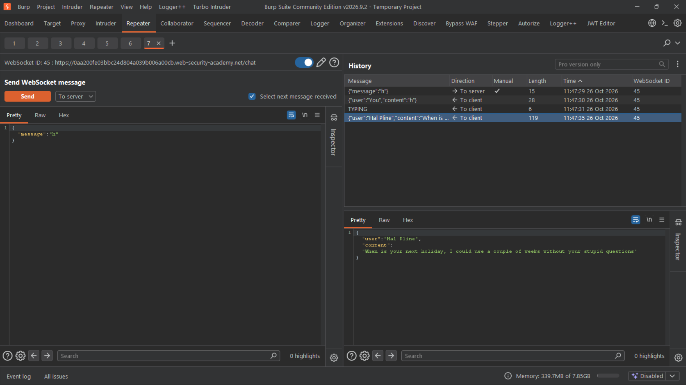
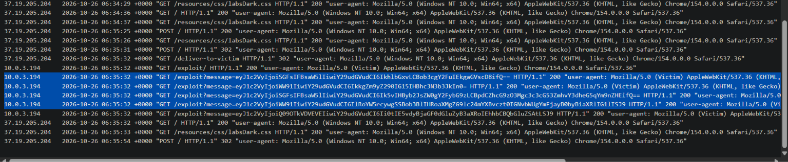

# Lab - Cross-site WebSocket hijacking

**Platform:** PortSwigger Web Security Academy 
**Category:** WebSockets / Cross-Site Request Forgery (CSRF) 
**Difficulty:** Practitioner 
**Date Solved:** 2026-10-26 
**Severity:** High — CVSS 3.1: 7.1 (conditional estimate), CVSS:3.1/AV:N/AC:L/PR:N/UI:R/S:U/C:H/I:H/A:N.

## Summary

The chat WebSocket accepted a cookie-authenticated connection without adequate protection against cross-origin initiation. In the lab, a page on a separate origin could cause a victim browser to open a WebSocket using the victim's existing session. The server then sent chat history over that connection. The history included a message containing the user's password, enabling account takeover in the lab.

This is Cross-Site WebSocket Hijacking (CSWSH): a cross-origin page induces a browser to establish a WebSocket connection that is authenticated by ambient credentials, while the server fails to properly verify the requesting origin and protect the handshake against forgery.

## Affected Component

- WebSocket endpoint: `/chat`
- Lab: [Cross-site WebSocket hijacking](https://portswigger.net/web-security/websockets/cross-site-websocket-hijacking)

## Steps to Reproduce

1. In the authorized lab, log in as the test user and open the live chat. Confirm the WebSocket handshake and messages in Burp Proxy's WebSockets history.
2. Review the handshake and determine whether the server relies on the session cookie without effective Origin validation or another server-verified CSRF defense.
3. In the lab's exploit workflow, induce a victim browser to open the chat WebSocket from a separate origin.
4. Observe that sending a message to the server can trigger the connection to return the chat history even though the cross-origin page is not logged in as the victim.
5. Review the messages received through the connection. In the lab, the chat history exposed a password that could be used to access the victim test account.

## Proof of Concept

**POC notes**

- The first screenshot shows that sending a message to a “To server” WebSocket request caused the full chat history to be returned, even though the attacker was unauthenticated.
- The second screenshot shows the encoded chat messages collected by the attacker-side exploit page while the browser made the cross-origin WebSocket connection.
- PortSwigger's walkthrough demonstrates a Collaborator-based collection workflow. I used Burp Suite Community Edition, which does not include Collaborator, so my collection method was different; the second screenshot records the resulting requests in the lab exploit-server logs.

The screenshots are included as supplied. The victim password is not reproduced as text in this report.

## Root Cause

The server accepted a cookie-authenticated WebSocket handshake without adequately verifying that the connection was initiated by the trusted application origin or requiring a separate, unpredictable server-validated token. Browsers may include applicable cookies when establishing a WebSocket, so relying on the session cookie alone can allow a hostile origin to create a connection in a logged-in user's context.

The WebSocket opening handshake begins as an HTTP request, but traditional CSRF assumptions and protections must be applied deliberately to the upgrade flow. In particular, the server must validate the `Origin` header against an explicit allowlist and protect the handshake with appropriate authentication and CSRF controls.

## Impact

**Technical**
- An attacker could cause an authenticated victim's browser to establish a WebSocket connection and read data the server sends over it.
- If the channel also accepts privileged commands, the attacker may be able to perform actions in the victim's application context, depending on the server's authorization model.
- In the lab, chat history contained a password, which enabled takeover of the test account.

**Business / Real-World**
- Exposure may include chat contents, personal information, account data, or other state delivered through the WebSocket.
- Account takeover or unauthorized actions depend on the data exposed, the operations available over the channel, and the affected account's privileges. The lab demonstrates its own test scenario and does not establish impact for any production service.

**Scope**
- Demonstrated only against the isolated PortSwigger Web Security Academy lab and its simulated victim account. No production system was tested.

## Remediation

- Validate the WebSocket handshake's `Origin` header against an explicit allowlist and reject absent or unexpected origins where appropriate.
- Require robust authentication and a server-validated CSRF defense for cookie-authenticated WebSocket handshakes.
- Do not rely on `SameSite` cookie settings as the only defense; use them as defense in depth alongside Origin validation and handshake protections.
- Authorize each sensitive message/action on the server, rather than treating an established socket as blanket permission.
- Avoid sending secrets such as passwords through chat. Protect sensitive data in transit and at rest, and redact it from logs.

## Methodology Takeaway

Assess WebSocket handshakes for CSRF-like weaknesses as well as reviewing the messages sent after connection. Check whether the browser supplies ambient cookies cross-origin, whether the server validates `Origin`, whether a server-verified anti-CSRF value is required, and what data the channel sends before user interaction. When using Burp Community Edition, document the evidence collection method you used rather than assuming Collaborator functionality is available.

## References

- [PortSwigger Web Security Academy: Cross-site WebSocket hijacking](https://portswigger.net/web-security/websockets/cross-site-websocket-hijacking)
- [PortSwigger: WebSockets](https://portswigger.net/web-security/websockets)
- [PortSwigger: Cross-site request forgery (CSRF)](https://portswigger.net/web-security/csrf)
- [OWASP WebSocket Security Cheat Sheet](https://cheatsheetseries.owasp.org/cheatsheets/WebSocket_Security_Cheat_Sheet.html)
- [OWASP Cross-Site Request Forgery Prevention Cheat Sheet](https://cheatsheetseries.owasp.org/cheatsheets/Cross-Site_Request_Forgery_Prevention_Cheat_Sheet.html)
- [OWASP Cross-Site WebSocket Hijacking](https://owasp.org/www-community/attacks/WebSocket_Security_Cheat_Sheet#cross-site-websocket-hijacking)
- [RFC 6455: The WebSocket Protocol](https://www.rfc-editor.org/rfc/rfc6455)
- [CWE-352: Cross-Site Request Forgery (CSRF)](https://cwe.mitre.org/data/definitions/352.html)

**Tags:** #PortSwigger #WebSockets #CSWSH #CSRF #AccountTakeover
