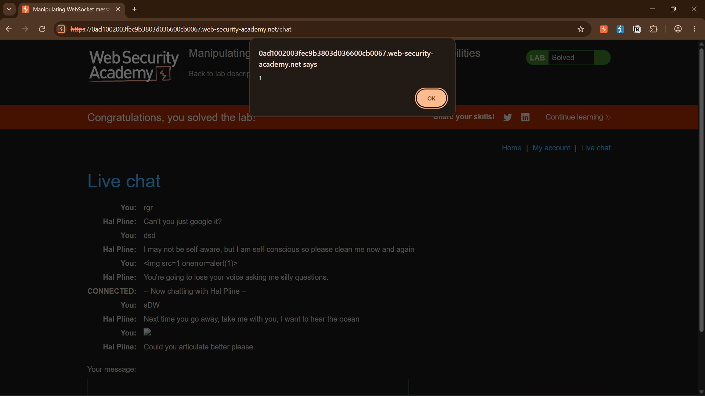
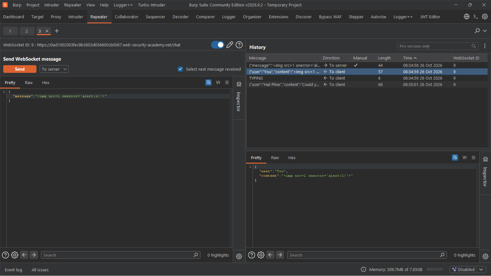

# Lab - Manipulating WebSocket messages to exploit vulnerabilities

**Platform:** PortSwigger Web Security Academy 
**Category:** WebSockets / Cross-Site Scripting (XSS) 
**Difficulty:** Practitioner 
**Date Solved:** 2026-10-26 
**Severity:** Low/Informational (PortSwigger lab rating; real-world severity depends on the recipient's session and privileges).

## Summary

A live chat feature used a WebSocket connection to send messages. The browser applied HTML encoding in client-side JavaScript before sending a normal message, but the server did not apply equivalent validation or safe output handling to the message received in a modified WebSocket frame. By intercepting and changing an outgoing frame in Burp, I bypassed the browser-side transformation. The lab's support-agent simulation later rendered the stored message, triggering the proof-of-concept alert in the recipient's browser context.

## Root Cause

Input handling relied on client-side JavaScript as a security boundary. A user can control their own browser and modify data before it reaches the server, so browser-side filtering cannot replace server-side validation and context-appropriate output encoding. The server stored and relayed the modified message without making it safe for the agent-facing HTML rendering context.

## Steps to Reproduce

1. Open the lab's live chat and send a benign message to establish the WebSocket connection.
2. Inspect the WebSocket messages in Burp Proxy. Compare a message containing HTML-significant characters with its transmitted representation to observe the client-side transformation.
3. Enable WebSocket message interception in Burp Proxy and send another message through the chat UI.
4. In the authorized lab, modify the intercepted outgoing frame to contain the lab's harmless XSS proof of concept, then forward it.
5. Observe the support-agent simulation render the stored message and trigger the proof-of-concept alert. The first POC image shows the alert and the solved lab; the second shows the intercepted WebSocket frame.

## Proof of Concept

The screenshots are included exactly as provided, without redaction.

The demonstrated effect was execution of a harmless alert in the simulated recipient's rendering context, not merely in the sender's browser.

## Impact

**Technical**
- The lab demonstrated stored script execution when the recipient-side chat view rendered the relayed message.
- In a real deployment, the impact depends on the privileges and accessible data of the recipient's browser session, as well as browser and application controls.

**Business / Real-World**
- Affected support personnel could be exposed to script execution in the context of the chat application.
- Potential consequences depend on the recipient's permissions and the application's protections. This report does not assume cookie theft or describe data-exfiltration steps.

**Scope**
- Demonstrated only against the isolated PortSwigger Web Security Academy lab and its simulated support-agent bot. No production system was tested.

## Remediation

- Treat all WebSocket messages as untrusted input and enforce server-side validation.
- Encode untrusted content for its output context when rendering chat messages; prefer text-only DOM APIs unless rich text is a product requirement.
- If rich text is required, use a maintained allowlist-based sanitizer on the server and still apply context-appropriate output handling.
- Apply a restrictive Content Security Policy as defense in depth, not as a replacement for safe rendering.
- Validate authorization and origin expectations for WebSocket connections and messages; log security-relevant events without recording sensitive message contents unnecessarily.

## Methodology Takeaway

Do not assume a value is safe because the normal UI transformed it. Determine whether a security control runs in attacker-controlled client code or on the server, and inspect what the server actually receives and later renders. The same principle applies to data submitted through WebSockets and other client-controlled channels.

## References

- [PortSwigger Web Security Academy: Manipulating WebSocket messages to exploit vulnerabilities](https://portswigger.net/web-security/websockets/lab-manipulating-messages-to-exploit-vulnerabilities)
- [PortSwigger: WebSockets](https://portswigger.net/web-security/websockets)
- [PortSwigger: Cross-site scripting](https://portswigger.net/web-security/cross-site-scripting)
- [PortSwigger: Stored XSS](https://portswigger.net/web-security/cross-site-scripting/stored)
- [OWASP WebSocket Security Cheat Sheet](https://cheatsheetseries.owasp.org/cheatsheets/WebSocket_Security_Cheat_Sheet.html)
- [OWASP Cross Site Scripting Prevention Cheat Sheet](https://cheatsheetseries.owasp.org/cheatsheets/Cross_Site_Scripting_Prevention_Cheat_Sheet.html)
- [OWASP Cross Site Scripting (XSS)](https://owasp.org/www-community/attacks/xss/)
- [CWE-79: Improper Neutralization of Input During Web Page Generation](https://cwe.mitre.org/data/definitions/79.html)

**Tags:** #PortSwigger #WebSockets #XSS #StoredXSS
