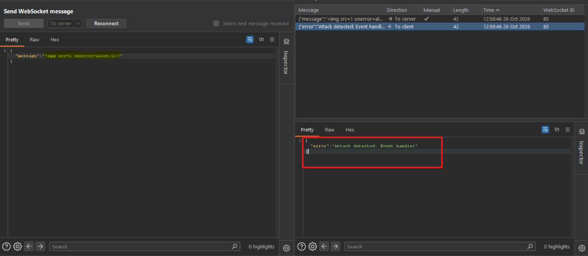
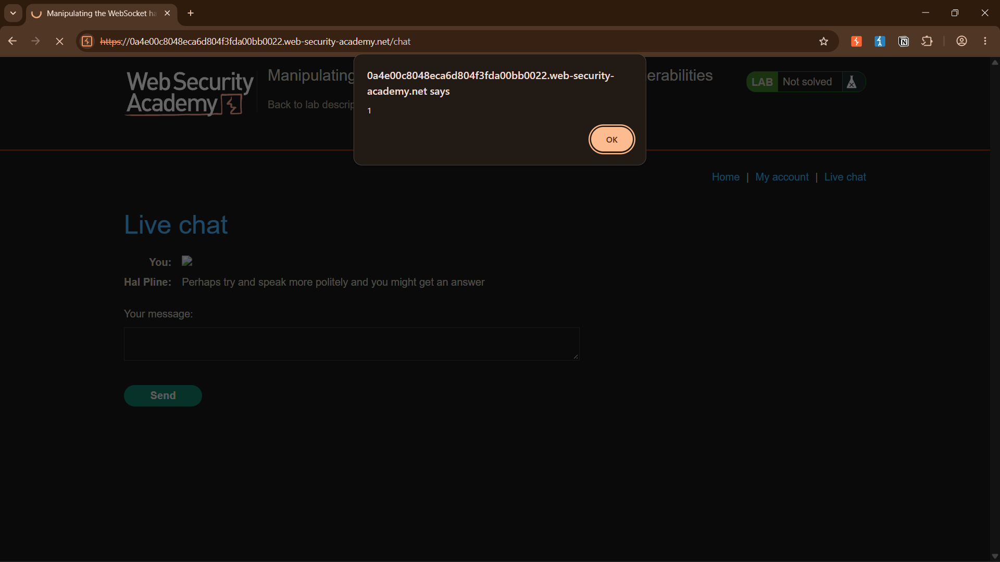

# Lab - Manipulating the WebSocket handshake to exploit vulnerabilities

**Date:** 2026-10-26<br>
**Target:** PortSwigger Web Security Academy — WebSockets<br>
**Vulnerability class:** Stored cross-site scripting (XSS) via WebSocket messages; filter and IP-ban behavior observed in the lab<br>
**Severity (as found in lab):** Medium-High — the lab demonstrates stored script execution and weaknesses in the lab's abuse controls; real-world severity depends on the recipient's session and privileges.

## Summary
A live chat feature over WebSockets is protected by a filter that detects and blocks obvious XSS payloads (e.g. `onerror=` in any case-sensitive literal form) sent as chat messages. On detection, the filter terminates the connection and **bans the client's IP** from reconnecting. However, the server determines client IP via the client-controllable `X-Forwarded-For` header rather than the actual TCP connection source — allowing the ban to be trivially bypassed by spoofing a different value. Once reconnected, the filter itself can be evaded by exploiting the gap between its literal string-matching logic and the browser's actual (case-insensitive, syntax-flexible) parsing of HTML/JS — specifically, mixed-case event handler attributes and JS tagged template literal syntax in place of function-call parentheses.

## Root Cause
Two independent flaws chained together:
 
1. **Trusting a client-supplied header for security decisions.** `X-Forwarded-For` exists to let a legitimate reverse proxy forward the original client IP when the server would otherwise only see the proxy's own IP. If the server blindly trusts this header without verifying it's actually coming from a trusted proxy hop, any client can claim to be any IP — defeating any IP-based control (bans, rate limits, allowlists) built on it.
2. **Pattern-matching filters validate syntax, not semantics.** The filter was evidently matching a literal substring (e.g. `onerror=`) rather than parsing the payload the way a browser actually interprets HTML. Browsers treat HTML attribute names as case-insensitive and support JS tagged template literal syntax (`` alert`1` ``) as a valid (if obscure) way to invoke a function — neither of which the filter accounted for.

## Steps to Reproduce

1. Open the authorized lab's live chat and establish a WebSocket connection. Inspect the connection and messages in Burp Proxy's WebSockets history.
2. Try sending a random text like "Hi"
3. Go to Websockets history in burp suite. Locate the 'To server' message with that message in
4. Send to repeater. Attempt the direct message-injection technique used in the prior WebSocket lab (<svg onload=alert(1)>).
6. Observe the server's **“Attack detected: Event handler”** response.
7. Observe that the WebSocket disconnects and the chat UI displays `System: --- Disconnected ---`.
8. In Burp Proxy, intercept the next WebSocket handshake request (a plain HTTP GET with `Upgrade: websocket` headers, sent when the page reloads/reconnects).
9. Add a new header to the handshake: `X-Forwarded-For: 1.1.1.1`.
10. Forward the request — the connection succeeds, confirming the ban is keyed to the spoofable header rather than the real source IP.
11. Send an obfuscated payload through the chat box: ``.
12. The filter does not flag it (case mismatch on `onerror`, and `alert`1`` evades any check specifically looking for `alert(`).
13. The payload is relayed to the simulated support agent's browser (`Direction: To client` in Burp's WebSockets history) and executes, confirmed by the `alert(1)` popup firing in that session.

## Proof of Concept

The first screenshot shows the outgoing “To server” message and the server response: `{"error":"Attack detected: Event handler"}`. In this attempt, detection also caused the lab to block the client's IP.



The second screenshot shows the corresponding live-chat UI state after the connection was terminated: `System: --- Disconnected ---`.

Handshake request (IP ban bypass):
```
GET /chat HTTP/1.1
Host: <lab-id>.web-security-academy.net
Connection: keep-alive, Upgrade
Upgrade: websocket
...
X-Forwarded-For: 1.1.1.1
```
 
Payload (filter bypass):
```json
{"user":"You","content":""}
```



These screenshots document the initial blocked attempt and disconnect behavior. The lab's successful completion is described in the supplied lab notes; these images do not show the successful bypass.

## Impact
- The ban-evasion flaw alone means any IP-based rate-limiting, blocking, or abuse-detection control the application relies on is ineffective against a motivated attacker — this generalizes to any endpoint, not just WebSockets.
- The filter-evasion flaw means the "protection" against XSS is largely theater — it blocks the most obvious attack strings while leaving the actual vulnerability (unsanitized server-side relay of chat content) fully exploitable via trivial reformatting.
- Combined, an attacker who gets banned on a first attempt is not meaningfully deterred — they can keep iterating payloads indefinitely by spoofing a new IP-equivalent on each reconnect.

## Remediation
- Do not trust `X-Forwarded-For` (or any client-supplied header) for IP-based security decisions unless the request is verified to originate from a specifically trusted, configured proxy, and even then only the trusted proxy's own appended value should be used, not an arbitrary client-supplied one.
- Replace pattern/substring-matching filters with proper output encoding at the point of storage or render — the only robust fix for stored XSS is never relying on blocklist-style input filtering in the first place.
- If a WAF-style filter is used as defense-in-depth, it should normalize input (case-fold, strip whitespace/encoding tricks) before matching, not match raw literal substrings.

## Methodology Takeaways

- A server-side detection response and a disconnected UI are useful evidence of how the application handles a blocked WebSocket message; distinguish that failure evidence from the later successful lab outcome.
- When a client sends an “Attack detected” response, record the response and resulting connection state rather than treating it as proof that the underlying unsafe rendering path is fixed.
- Burp Community Edition does not include Collaborator. Record the evidence-collection method actually used and do not assume the Collaborator workflow applies.

## Debugging Postmortem — Every Wrong Turn and Why
 
This lab took significantly longer than it should have, almost entirely due to **tooling friction, not a misunderstanding of the vulnerability**. Documented here because the actual attack technique was correctly identified on the first attempt — everything after that was fighting Burp Suite Community Edition's limitations and quirks.
 
**1. Assumed Repeater could directly test the live WebSocket session.**
Early troubleshooting (carried over from a prior lab's habits) involved testing payloads in Repeater's "Send WebSocket message" panel with direction set to "To client." This simulates an inbound push to the attacker's own browser — useful for confirming a payload *would* execute, but functionally disconnected from the real session with the server and the support agent. Correction: always distinguish between "proving a payload executes in a browser" (any direction, any session) versus "proving the exploit actually reaches the real target" (must go through the real, live connection, `To server`).
 
**2. Attempted to manually reconstruct the handshake via Repeater's "Select WebSocket" dialog.**
This repeatedly failed with `Invalid upgrade request`. Root cause was twofold: (a) the `Connection` header must read `keep-alive, Upgrade`, not just `Upgrade`, for Burp's own handshake validator to accept it; (b) this dialog is a manual, from-scratch reconstruction of a handshake separate from the browser's real connection — even once correctly formatted, it does not represent the actual session the live chat page uses. This path was abandoned in favor of intercepting the real browser's own handshake traffic, which is the correct approach.
 
**3. Attempted to automate the header injection via Match and Replace, using a literal `\r\n` in the Replace field.**
This was based on the (incorrect) assumption that Burp's Match and Replace text field interprets typed backslash-escape sequences as actual control characters. It does not — the rule injected the literal text `r` and `n` directly into the Host header, corrupting it (`...academy.netrX-Forwarded-For: 1.1.1.1` as one malformed string) rather than creating a genuine new header line. This rule never worked and was abandoned in favor of manually pressing Enter inside Burp's live request editor, which correctly inserts a real line break.
 
**4. Hit a `400 Bad Request — Protocol error` after correctly adding the spoofed header.**
This was the actual blocking issue for most of the session. The intercepted handshake request was negotiated over HTTP/2 (`GET /chat HTTP/2`), but the WebSocket upgrade mechanism (`Connection: Upgrade`, `Upgrade: websocket` headers) is fundamentally an HTTP/1.1-era construct and is invalid under HTTP/2. The browser normally handles this negotiation transparently; manually intercepting, editing, and forwarding the request while Burp kept it tagged as HTTP/2 produced a request the server correctly rejected as malformed. Fix: disabling HTTP/2 in Burp's Proxy settings for the target forced the connection to negotiate as HTTP/1.1, at which point the exact same header-injection technique worked immediately and without further issue.
 
**Net assessment:** the hypothesis and technique (spoof the ban via a trusted header, then bypass the filter via case/syntax evasion) were correct from the first read of the lab's hint. All subsequent time was spent diagnosing tooling-layer failures that had nothing to do with the underlying vulnerability — a useful reminder that **when a technique that should work keeps failing, suspect the tool's request formatting/protocol handling before re-questioning the vulnerability logic itself.**

## References

- [PortSwigger Web Security Academy: Manipulating the WebSocket handshake to exploit vulnerabilities](https://portswigger.net/web-security/websockets/lab-manipulating-handshake-to-exploit-vulnerabilities)
- [PortSwigger: WebSockets](https://portswigger.net/web-security/websockets)
- [PortSwigger: Cross-site scripting](https://portswigger.net/web-security/cross-site-scripting)
- [OWASP WebSocket Security Cheat Sheet](https://cheatsheetseries.owasp.org/cheatsheets/WebSocket_Security_Cheat_Sheet.html)
- [OWASP Cross Site Scripting Prevention Cheat Sheet](https://cheatsheetseries.owasp.org/cheatsheets/Cross_Site_Scripting_Prevention_Cheat_Sheet.html)
- [CWE-79: Improper Neutralization of Input During Web Page Generation](https://cwe.mitre.org/data/definitions/79.html)

**Tags:** #PortSwigger #WebSockets #XSS #StoredXSS
