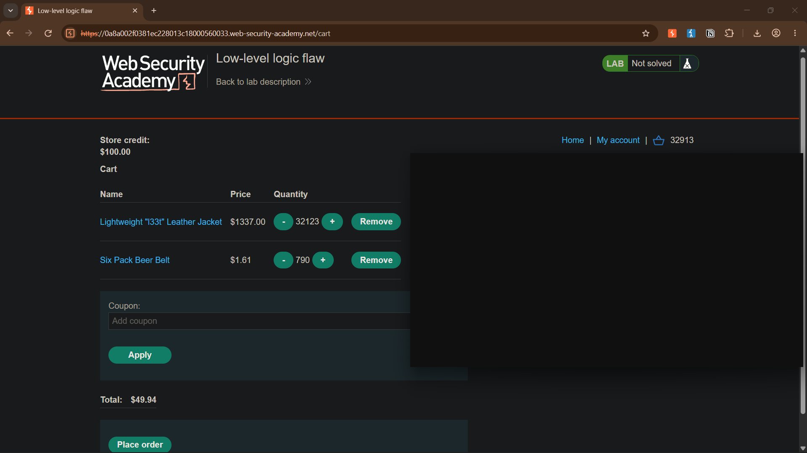
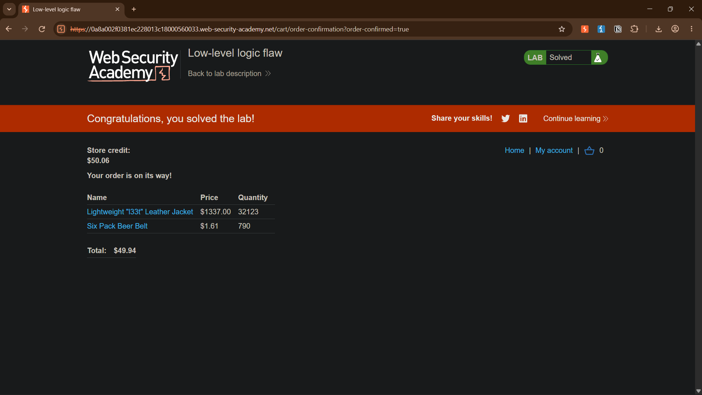

# Low-level logic flaw

**Platform:** PortSwigger Web Security Academy
**Category:** Business Logic / Integer Overflow
**Difficulty:** Practitioner
**Date Solved:** 2026-10-22
**Severity:** High

## Summary

The cart accepts multiple individually valid quantity updates but does not safely bound the cumulative quantity or the resulting line-item value. Repeated additions of the $1,337.00 jacket cause the product of its price in cents and quantity to exceed the signed 32-bit integer range. The arithmetic wraps to a negative line-item amount, allowing the cart total to be brought within the account's $100 store credit by adding a small quantity of a cheaper product. The order is then accepted for $49.94 instead of the jacket's actual price.

## Affected Component

`POST /cart` — accepts `productId`, `redir`, and `quantity`. The request-level quantity limit does not protect the cumulative cart quantity or the price-times-quantity calculation.

## Steps to Reproduce

1. Attempt to purchase the Lightweight "l33t" Leather Jacket at its listed price of $1,337.00. The order is rejected because the account has only $100 in store credit.
2. Inspect the `POST /cart` request. The client-side input is limited, but the server accepts a quantity of up to 99 in an individual request; larger values are rejected as an invalid `quantity`.
3. Repeat valid add-to-cart requests for the same product and confirm that each request increases the existing quantity instead of replacing it.
4. Calculate the cumulative quantity needed for the product of the item's price in cents and quantity to exceed the signed 32-bit maximum (`2,147,483,647`). For the $1,337.00 jacket, the overflow threshold is crossed after 16,062 units.
5. Add the jacket in repeated requests of `quantity=99`, followed by a remainder request, until the cumulative quantity reaches 32,123. At this point, the line-item calculation has wrapped and the cart total is negative.
6. Add 790 units of the $1.61 Six Pack Beer Belt. This offsets the negative amount, bringing the displayed total to $49.94.
7. Place the order. The lab confirms the order, charging the manipulated total against the $100 store credit.

## Proof of Concept

At 32,123 jackets, the line-item calculation is:

```text
(1,337.00 dollars × 100 cents/dollar) × 32,123 = 4,294,845,100 cents
32-bit signed wraparound: 4,294,845,100 mod 2^32 = -122,196 cents
```

The belt adds `790 × 161 = 127,190` cents, leaving a final total of `4,994` cents ($49.94). The application accepted the order and reduced the account's store credit from $100.00 to $50.06.





## Root Cause

The application validates each submitted quantity independently but does not enforce a safe bound on the cumulative cart quantity or use checked arithmetic for the line-item total. Multiplying the stored price by the accumulated quantity exceeds the signed 32-bit range and produces a negative amount. Checkout trusts this invalid calculated total instead of rejecting it or recalculating it with overflow-safe arithmetic.

## Impact

**Technical**
- Integer overflow in the cart's price-times-quantity calculation produces a negative line-item amount.
- The final order total can be manipulated to a value below the legitimate cost.

**Business / Real-World**
- An attacker could obtain goods at a substantial discount or effectively for free.
- Incorrect cart and order values could also undermine inventory accounting, payment reconciliation, and financial reporting.

**Scope**
- Demonstrated in the isolated PortSwigger Web Security Academy lab. No production system was tested.

## Remediation

- Use checked or sufficiently wide arithmetic for quantity and monetary calculations; reject operations that overflow rather than allowing wraparound.
- Enforce limits against the cumulative cart quantity and line-item value, not only against each individual request.
- Calculate monetary totals in integer minor units using overflow-safe operations, and validate that every line item and the final order total are non-negative and within business limits.
- Recalculate and validate the complete order server-side at checkout using trusted product prices and persisted quantities.
- Add tests for boundary values, repeated incremental updates, and totals immediately below and above the numeric limits.

## Lessons Learned & Patterns

- A per-request input limit does not guarantee that accumulated server-side state remains within safe bounds.
- Test calculations as well as stored fields: even a modest quantity can overflow when multiplied by a high unit price.
- Validate cart invariants at checkout; do not assume a displayed or previously calculated total is safe to charge.

## References

- [PortSwigger Web Security Academy: Lab — Low-level logic flaw](https://portswigger.net/web-security/logic-flaws/examples/lab-logic-flaws-low-level)
- [PortSwigger: Business logic vulnerabilities](https://portswigger.net/web-security/logic-flaws)
- [OWASP Business Logic Security Cheat Sheet](https://cheatsheetseries.owasp.org/cheatsheets/Business_Logic_Security_Cheat_Sheet.html)
- [OWASP Web Security Testing Guide: Business Logic Testing](https://owasp.org/www-project-web-security-testing-guide/stable/4-Web_Application_Security_Testing/10-Business_Logic_Testing/)
- [CWE-190: Integer Overflow or Wraparound](https://cwe.mitre.org/data/definitions/190.html)

**Tags:** #PortSwigger #BusinessLogic #IntegerOverflow #PriceManipulation
