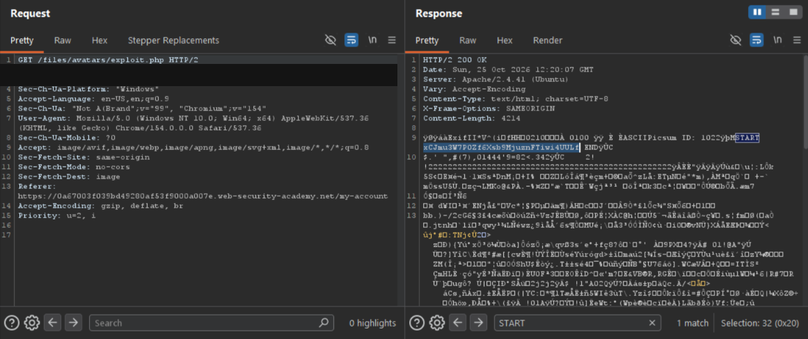

# Lab - Remote code execution via polyglot web shell upload

**Platform:** PortSwigger Web Security Academy
**Category:** File Upload
**Difficulty:** Practitioner
**Date Solved:** 2026-10-25
**Severity:** Critical (CVSS 3.1: 9.9, conditional estimate)

## Summary

The avatar upload feature checked that uploaded content was a valid image, and rejected an ordinary non-image file with `HTTP/2 403 Forbidden`. However, the application retained the original uploaded bytes and stored the file in a location where a PHP-named upload could be executed. A valid image containing a server-side payload in metadata passed image validation while remaining interpretable as executable code by the server.

The key issue was not bypassing image parsing or changing the filename check. It was that two components interpreted one file differently: the image validator accepted its image structure, while the server-side runtime interpreted embedded code when the uploaded file was requested. The authorized lab was solved after requesting the stored file and locating the response marker and secret in the returned data.

## Affected Component

- Upload endpoint: `POST /my-account/avatar`
- Uploaded-file path: `/files/avatars/<uploaded-filename>`
- Lab: [Remote code execution via polyglot web shell upload](https://portswigger.net/web-security/file-upload/lab-file-upload-remote-code-execution-via-polyglot-web-shell-upload)

The lab hostname, session data, executable payload, and secret are omitted.

## Steps to Reproduce

1. In the authorized lab, upload a normal image and inspect the avatar upload request.
2. Try a non-image file and observe the deliberate `403 Forbidden` response stating that the file is not a valid image. This confirms rejection for that input; a status code alone does not identify every validation step or reveal how the file is subsequently handled.
3. Inspect the allowed image formats and the upload and retrieval behavior. The filename extension alone did not determine whether content validation accepted the file.
4. In the isolated lab, test the hypothesis that a file can remain valid to the image validator while also containing data interpreted as server-side code. The exact polyglot construction and executable content are intentionally omitted.
5. Upload the lab-only polyglot file through the avatar feature, then request its stored path.
6. Inspect the response for the marker and lab secret. The attached evidence shows the retrieved response and marker; the lab reported as solved.

## Proof of Concept

The following outline records the observed flow without publishing an executable file-generation command or payload. The screenshot is evidence from the authorized lab; the session cookie has been redacted.

```http
POST /my-account/avatar HTTP/2
Content-Disposition: form-data; name="avatar"; filename="[redacted lab filename]"
Content-Type: image/[accepted image type]

[Valid image containing lab-only polyglot data omitted]

GET /files/avatars/[stored filename] HTTP/2
```

The upload was accepted as an image. Requesting the stored file returned `HTTP/2 200 OK`; the response contained image data and the marker used to locate the lab result. The secret itself is not reproduced here.



## Root Cause

The application validated the uploaded bytes as an image but did not ensure that the accepted bytes were inert when later served. The server retained the original file and made it available through a path whose handling allowed the PHP runtime to interpret embedded code.

Content validation and safe serving are separate controls. Recognizing a valid image signature or successfully parsing an image does not, by itself, prevent another interpreter from finding and executing embedded code. Safely decoding and re-encoding image data, together with non-executable storage and serving, would address this class of mismatch more effectively than trusting the extension or a successful image check alone.

## Impact

**Technical**
- The demonstrated primitive was server-side code execution through an uploaded file.
- The lab proof retrieved a designated secret. That is evidence of confidentiality impact, not a limit on what code execution may enable in the same process context.

**Business / Real-World**
- If an equivalent production issue allowed arbitrary code execution, the attacker could affect data and operations available to the web-server process.
- The actual ceiling depends on authentication requirements, process privileges, filesystem and network isolation, runtime configuration, and whether uploaded content is executed on retrieval.
- The lab demonstrates one specific application and server configuration; it does not imply that all image uploaders or production systems behave the same way.

**Scope**
- Demonstrated only against the isolated PortSwigger Web Security Academy lab. No production system was tested.

## Remediation

- Decode and re-encode uploaded images with a maintained image library; do not serve the original attacker-controlled byte stream as an executable file.
- Store uploads outside the web root and serve them through a handler that returns inert content with a safe content type and `X-Content-Type-Options: nosniff`.
- Disable script execution in upload directories and configure the web server so uploaded content cannot be dispatched to a server-side interpreter.
- Generate storage names server-side and apply a narrow allowlist for file types and business requirements. Treat filenames and client-supplied MIME types as untrusted.
- Run image processing and file-serving components with least privilege, and add regression tests using files that are valid images but contain unexpected metadata or trailing data.

## Investigation Notes

- **Initial hypothesis:** A parser might interpret an image's metadata or other non-pixel data differently from the server-side runtime. The polyglot concept was directionally useful: one byte stream can be meaningful to more than one parser.
- **Recon observation:** The application accepted several genuine image formats regardless of filename extension, while rejecting raw non-image content. This showed why testing only the filename was insufficient.
- **Interpreting the `403`:** The explicit invalid-image message supports the conclusion that the submitted non-image input was deliberately rejected. It does not prove that a particular magic-byte check was used or that all subsequent storage and serving behavior is safe.
- **Interpreting other status codes:** A `500` can indicate an unhandled processing failure but does not by itself establish an exploitable parser flaw; a `404` can reflect routing, authorization, or a missing object. Status codes need to be interpreted with the response and request flow, not treated as definitive vulnerability diagnoses.
- **Verification:** Upload acceptance alone was not proof of execution. Retrieving the stored file and finding the expected marker and lab result supplied the relevant evidence.
- **Methodology:** Before each upload test, exclude images from Burp's HTTP history MIME-type filters and clear values from both file-extension filter fields. This keeps relevant requests visible.

## Lessons Learned & Patterns

- A file can be valid to one parser and dangerous to another; validate the upload-to-storage-to-retrieval chain, not just the file at intake.
- Image validity does not guarantee safe serving. Re-encoding and non-executable storage reduce ambiguity between parsers.
- A filename extension, MIME type, or successful image check is not a substitute for controlling how stored content is served.
- Treat error responses as evidence about one observed request, not a complete description of server internals.
- Preserve the distinction between demonstrated impact and the execution primitive's potential ceiling; state assumptions about privileges and isolation.
- Configure traffic-history filters before testing and record the settings to avoid hiding the requests needed to verify behavior.

## References

- [PortSwigger Web Security Academy: Remote code execution via polyglot web shell upload](https://portswigger.net/web-security/file-upload/lab-file-upload-remote-code-execution-via-polyglot-web-shell-upload)
- [PortSwigger: File upload vulnerabilities](https://portswigger.net/web-security/file-upload)
- [Repository: PHP Upload Security Testing Reference](https://github.com/MalikHettige/Bug-bounty-writeups/blob/main/resources/php-upload-security-testing.md)
- [OWASP: File Upload Cheat Sheet](https://cheatsheetseries.owasp.org/cheatsheets/File_Upload_Cheat_Sheet.html)
- [CWE-434: Unrestricted Upload of File with Dangerous Type](https://cwe.mitre.org/data/definitions/434.html)
- [CWE-436: Interpretation Conflict](https://cwe.mitre.org/data/definitions/436.html)

## Severity Assessment (CVSS 3.1)

**Rating:** Critical
**Approximate score:** 9.9
**Vector:** `CVSS:3.1/AV:N/AC:L/PR:L/UI:N/S:C/C:H/I:H/A:H`

- **AV:N (Network):** The vulnerable upload and retrieval functions are reachable over HTTP(S).
- **AC:L (Low):** In the lab, the polyglot upload and retrieval were reproducible without a race or timing window.
- **PR:L (Low):** The avatar workflow requires an authenticated, low-privilege account.
- **UI:N (None):** The authenticated attacker performs the upload and retrieval; no separate victim action is required.
- **S:C (Changed):** This estimate treats successful server-side code execution as crossing from the upload feature into the server-side runtime and its resources. Scope could be Unchanged if both components share the same security authority under the applicable CVSS boundary.
- **C:H (High):** Code execution in the web-server process may expose sensitive information available to that process.
- **I:H (High):** The same primitive may modify data accessible to the process.
- **A:H (High):** The primitive may disrupt the application or affect processes and files available to the server account.

This estimate assumes a low-privilege authenticated account can reach the vulnerable upload and that the execution context has high impact across confidentiality, integrity, and availability. The lab demonstrated retrieval of a designated secret; production impact and the Scope selection depend on the real deployment's execution authority and isolation.

**Tags:** #PortSwigger #FileUpload #Polyglot #WebShell #RemoteCodeExecution
