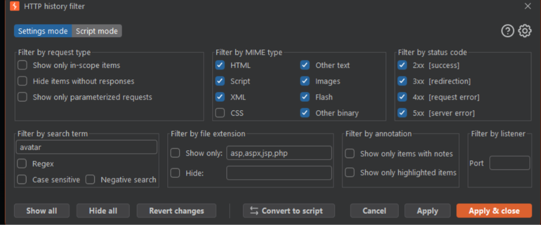

# Lab - Web shell upload via obfuscated file extension

**Platform:** PortSwigger Web Security Academy
**Category:** File Upload
**Difficulty:** Practitioner
**Date Solved:** 2026-10-25
**Severity:** Critical (CVSS 3.1: 9.9, assumed)

## Summary

The avatar upload feature applied its filename validation and file-saving logic using inconsistent string handling. In the authorized lab, a filename containing an obfuscated extension passed validation as an allowed image, but the storage layer interpreted the embedded null character as the end of the filename. The file was consequently saved under an executable script extension, and requesting it returned the lab's secret.

This is a parsing-layer mismatch: the validation and storage components interpreted the same filename differently. It differs from handler-mapping bypasses, where the server's execution configuration treats an otherwise accepted suffix as executable.

## Affected Component

- Upload endpoint: `POST /my-account/avatar`
- Uploaded-file path: `/files/avatars/<stored-filename>`
- Lab: [Web shell upload via obfuscated file extension](https://portswigger.net/web-security/file-upload/lab-file-upload-extensions)

The lab hostname, authentication data, exact obfuscated filename, executable file body, and secret are omitted.

## Steps to Reproduce

1. Open the authorized lab account's avatar upload workflow and upload a normal image to identify the baseline request.
2. Try a standard script-extension upload in the lab. The rejection confirms that the application applies an extension check.
3. Before further upload testing, configure Burp Suite's HTTP history filters:
   - Under **Filter by MIME type**, uncheck **Images** so image traffic is excluded from the history.
   - Under **Filter by file extension**, clear any values in both **Show only** and **Hide**.
   - Apply the filters, then continue inspecting the relevant upload and retrieval requests.
4. In the isolated lab, submit a filename with an obfuscated extension that the validation layer accepts but the storage layer interprets differently. The exact filename and null-byte construction are intentionally redacted.
5. Observe the server's upload confirmation and compare the filename it reports with the submitted name. The shortened stored name was a clue that the backend had truncated the filename.
6. Request the stored file by its effective name. The response returned the lab's expected secret, confirming server-side execution.

## Proof of Concept

The request details below are intentionally redacted. They preserve the vulnerable endpoint and verification flow without publishing a ready-to-send filename or executable payload.

```http
POST /my-account/avatar HTTP/2
Content-Disposition: form-data; name="avatar"; filename="[redacted obfuscated filename]"
Content-Type: image/png

[Lab-only file content omitted]
```

The upload was accepted, and the application indicated that the saved filename was shorter than the submitted name. A subsequent request to the corresponding stored-file path returned `HTTP/2 200 OK` with the lab's expected secret.

**Burp Suite history filter setup:** Exclude image MIME types and clear both file-extension filter fields before testing so the history view does not hide relevant requests. The screenshot shows the filter controls to adjust; it is a setup reference, not evidence of the successful upload.



## Root Cause

The upload-validation layer checked the full submitted filename, while a later storage layer used null-terminated string handling. Because these components disagreed about where the filename ended, the validation decision applied to a different effective filename than the one used on disk.

The shortened filename in the upload confirmation was a useful indicator of truncation. It distinguished a parsing mismatch from a case where the stored filename remains intact but the server's handler configuration interprets it unexpectedly.

## Impact

**Technical**
- The demonstrated primitive allowed an uploaded file to be stored and executed as server-side code.
- The lab's proof read a designated secret. That was the verification action; it does not define the full ceiling of the code-execution primitive.

**Business / Real-World**
- Assuming an equivalent issue allowed an attacker to execute code in the web-server process context, confidentiality, integrity, and availability could be affected up to the privileges and reachable resources of that process.
- Actual production impact would depend on upload authorization, runtime privileges, filesystem isolation, and other server controls.

**Scope**
- Demonstrated only against the isolated PortSwigger Web Security Academy lab. No production system was tested.

## Remediation

- Reject null bytes and other invalid filename characters at the earliest input boundary; do not rely on language-specific truncation behavior.
- Canonicalize and validate the same filename representation that will be used for storage, and avoid passing untrusted filenames between components with different string semantics.
- Generate opaque storage names server-side and keep uploaded content outside directories where it can be executed.
- Validate file content using a trusted parser and a narrow allowlist; treat client-supplied extensions and MIME types as untrusted.
- Run upload processing with least privilege and add regression tests for encoded, truncated, and otherwise ambiguous filenames.

## Investigation Notes

- **Baseline question:** Is a standard script extension rejected, and what does that reveal about the upload policy? The rejection confirmed an extension check but did not establish that every processing layer used the same filename.
- **Platform hypothesis:** The key hypothesis was that validation and file persistence might interpret a filename differently. This was distinct from approaches that depend on web-server handler matching.
- **Evidence clue:** A success message that reports a shorter filename than the submitted value suggests truncation or canonicalization. Compare both representations before deciding what path to request.
- **Technique selection:** Once the observed behavior pointed to truncation, the useful next step was to test that parsing hypothesis rather than mixing in unrelated handler-matching or header-validation theories.
- **Methodology note:** Before each related upload test, exclude images in Burp's MIME-type filters and clear the values in both file-extension filter fields. This keeps the HTTP history view from concealing relevant evidence.

## Lessons Learned & Patterns

- Validate the exact canonical filename that will be stored, not a representation that later layers interpret differently.
- Treat filename parsing, validation, storage, and retrieval as one end-to-end security boundary.
- A mismatch between submitted and reported filenames is evidence worth investigating; it can identify normalization or truncation behavior.
- Keep hypotheses distinct: parsing-layer truncation, handler configuration, extension validation, and MIME-type validation have different causes and require different fixes.
- Configure traffic-history filters before testing and record the settings so that hidden requests are not mistaken for missing behavior.
- Rate impact based on the code-execution primitive and its execution context, while clearly separating the demonstrated secret read from the broader potential impact.

## References

- [PortSwigger Web Security Academy: Web shell upload via obfuscated file extension](https://portswigger.net/web-security/file-upload/lab-file-upload-extensions)
- [PortSwigger: File upload vulnerabilities](https://portswigger.net/web-security/file-upload)
- [Repository: PHP Upload Security Testing Reference](https://github.com/MalikHettige/Bug-bounty-writeups/blob/main/resources/php-upload-security-testing.md)
- [OWASP: File Upload Cheat Sheet](https://cheatsheetseries.owasp.org/cheatsheets/File_Upload_Cheat_Sheet.html)
- [CWE-158: Improper Neutralization of Null Byte or NUL Character](https://cwe.mitre.org/data/definitions/158.html)
- [CWE-434: Unrestricted Upload of File with Dangerous Type](https://cwe.mitre.org/data/definitions/434.html)

## Severity Assessment (CVSS 3.1)

**Rating:** Critical
**Approximate score:** 9.9
**Vector:** `CVSS:3.1/AV:N/AC:L/PR:L/UI:N/S:C/C:H/I:H/A:H`

- **AV:N (Network):** The upload and retrieval endpoints are accessed over HTTP(S).
- **AC:L (Low):** In the lab, the filename interpretation mismatch was reproducible without a race or separate victim action.
- **PR:L (Low):** The avatar workflow requires an authenticated, low-privilege account.
- **UI:N (None):** The authenticated attacker performs the upload and retrieval; no separate victim action is required.
- **S:C (Changed):** The vulnerable upload feature enables execution in the server-side runtime, affecting resources beyond the upload component itself.
- **C:H (High):** Code execution in the web-server process may expose sensitive data available to that process.
- **I:H (High):** The same execution primitive may modify data accessible to the process.
- **A:H (High):** The primitive may disrupt services or affect files and processes accessible to the web-server account.

This estimate assumes that the vulnerable upload is reachable by an ordinary authenticated user and that the execution context has broad confidentiality, integrity, and availability impact. The lab proves the parsing mismatch and secret retrieval; actual production impact depends on the process's permissions and isolation.

**Tags:** #PortSwigger #FileUpload #ObfuscatedExtension #NullByte #WebShell
