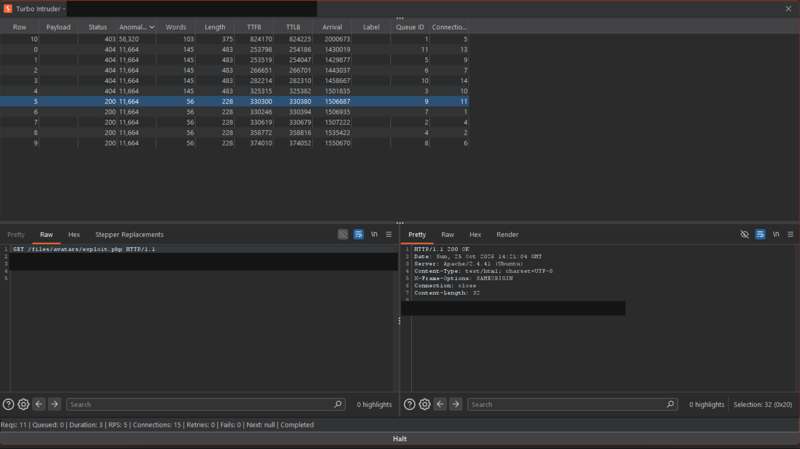

# Lab - Web shell upload via race condition

**Platform:** PortSwigger Web Security Academy<br>
**Category:** File Upload / Race Condition<br>
**Difficulty:** Practitioner<br>
**Date Solved:** 2026-10-25<br>
**Severity:** Critical — CVSS 3.1: 9.1 (conditional estimate), `CVSS:3.1/AV:N/AC:H/PR:L/UI:N/S:C/C:H/I:H/A:H`. 

## Summary

The avatar upload flow made a newly uploaded file reachable before the server finished validating it. In the authorized lab, a concurrent request burst produced mixed retrieval results: several returned `HTTP/2 200 OK` with the lab secret and others returned `404 Not Found`; the upload request ultimately returned `403 Forbidden`.

The result is consistent with a time-of-check/time-of-use (TOCTOU) flaw: the file may have been exposed while validation was pending, even though the upload was ultimately rejected. The mixed responses do not establish the exact order of each request or prove when any cleanup occurred.

## Affected Component

- Upload endpoint: `POST /my-account/avatar`
- Uploaded-file path: `/files/avatars/<uploaded-filename>`
- Lab: [Web shell upload via race condition](https://portswigger.net/web-security/file-upload/lab-file-upload-web-shell-upload-via-race-condition)

The lab hostname, session cookie, uploaded executable content, and returned secret are omitted.

## Steps to Reproduce

1. In the authorized lab, inspect the avatar upload and file-retrieval flow. Establish the expected behavior for accepted and rejected uploads.
2. In the authorized lab, use Burp Suite Turbo Intruder to coordinate an upload request with concurrent retrieval attempts for the anticipated stored path.
3. Ensure the connection pool has at least one connection for every request held at the gate. The first attempt gated 11 requests but allocated 10 connections, producing a deadlock because the gate could not release until every request was ready.
4. Repeat the coordinated test with sufficient connections. Compare the upload result with the retrieval responses; in this run, some retrievals returned the lab secret even though the upload was ultimately rejected.
5. Compare all retrieval outcomes. Successful and unsuccessful responses from the same run are consistent with a short-lived exposure interval.

The request orchestration details and executable upload body are intentionally not included; this report describes the observed behavior in the isolated lab.

## Proof of Concept

The relevant requests were a lab-only avatar upload and concurrent reads from the path where the uploaded file would be stored. The uploaded content and authorization data are redacted.

```http
POST /my-account/avatar HTTP/2
Content-Disposition: form-data; name="avatar"; filename="[redacted lab filename]"
Content-Type: [lab upload content type]

[Lab-only file content omitted]

GET /files/avatars/[expected stored filename] HTTP/2
```

**Observed results:** In the Turbo Intruder run, the upload request returned `403 Forbidden`; five retrieval attempts returned `200 OK` with the lab secret, and five returned `404 Not Found`. The evidence shows mixed results within a coordinated run. It supports transient file availability, but the displayed Arrival values do not establish a simple rule that every earlier request succeeded and every later request failed, nor do they reveal the exact validation or deletion timestamps.



## Root Cause

The observed behavior is consistent with the file becoming accessible before the validation decision was complete. If validation later failed, cleanup may have removed the file, leaving a window in which concurrent requests could access it.

This is a TOCTOU issue rather than simply a failure to detect invalid content: the validator eventually rejected the upload, yet the storage and serving lifecycle may have exposed it before that decision. A robust design should keep an upload quarantined and inaccessible until validation succeeds, then publish it atomically.

## Impact

**Technical**
- A retrieval request could access the uploaded content during the coordinated run even though the upload ultimately returned a rejection.
- In the lab, the uploaded file executed when retrieved and returned the designated secret.

**Business / Real-World**
- If an equivalent production flow made attacker-controlled executable content available during validation, successful exploitation could expose data or affect the server process, depending on its privileges and isolation.
- The exploitability of a race depends on the exposure window, request latency, validation behavior, concurrency limits, and other deployment controls. The lab's successful run does not establish that every production target has the same window.

**Scope**
- Demonstrated only against the isolated PortSwigger Web Security Academy lab. No production system was tested.

## Remediation

- Write new uploads to a private quarantine location that is not reachable through web requests.
- Complete content validation and malware scanning before making a file visible to users or executable by a server-side runtime.
- Publish accepted files atomically only after all checks pass; delete or retain rejected files only in inaccessible storage.
- Store uploads outside executable web roots and serve them through a handler that treats them as inert content.
- Add regression tests that issue concurrent retrieval attempts during upload validation and assert that no unapproved file is ever accessible.

## Investigation Notes

- **Initial question:** Did the final `403 Forbidden` mean the upload was safely rejected? The successful retrievals in the same run showed that the final upload response alone did not describe the file's earlier availability.
- **Race hypothesis:** The upload may be written and served before validation or cleanup completes. A coordinated upload/read run produced mixed `200` and `404` retrieval results while the upload ended with `403`, consistent with that hypothesis.
- **Arrival evidence:** The screenshot records request outcomes and timing metadata. Its displayed Arrival values do not prove the user's proposed earlier-200/later-404 ordering; the report therefore treats them as supporting context rather than definitive proof of the exact server-side sequence.
- **Turbo Intruder deadlock:** The first run gated 11 requests with only 10 concurrent connections. Since every gated request needed an available connection before the gate could release, the undersized pool prevented the run from completing. Allocating enough connections for all gated requests resolved that configuration error.
- **Methodology:** Before each upload test, exclude images from Burp's HTTP history MIME-type filters and clear values from both file-extension filter fields so relevant traffic remains visible.

## Lessons Learned & Patterns

- Correct validation can still be bypassed in effect if a file is served before validation completes.
- Treat upload, validation, publication, and retrieval as one lifecycle; the file should transition from private quarantine to public availability only after acceptance.
- A final rejection response does not prove that no concurrent request observed the file earlier.
- Mixed success and not-found responses are evidence of a possible timing window, but correlate them carefully with request timestamps and server behavior before inferring exact ordering.
- Gate-based race testing requires enough simultaneous connections to hold every gated request; otherwise the test itself can deadlock.
- Distinguish a TOCTOU exposure from validation bypasses based on extensions, MIME types, or parser interpretation. The underlying weakness and appropriate fix differ.

## References

- [PortSwigger Web Security Academy: Web shell upload via race condition](https://portswigger.net/web-security/file-upload/lab-file-upload-web-shell-upload-via-race-condition)
- [PortSwigger: File upload vulnerabilities](https://portswigger.net/web-security/file-upload)
- [PortSwigger: Race conditions](https://portswigger.net/web-security/race-conditions)
- [Repository: PHP Upload Security Testing Reference](https://github.com/MalikHettige/Bug-bounty-writeups/blob/main/resources/php-upload-security-testing.md)
- [OWASP: File Upload Cheat Sheet](https://cheatsheetseries.owasp.org/cheatsheets/File_Upload_Cheat_Sheet.html)
- [CWE-367: Time-of-check Time-of-use (TOCTOU) Race Condition](https://cwe.mitre.org/data/definitions/367.html)
- [CWE-434: Unrestricted Upload of File with Dangerous Type](https://cwe.mitre.org/data/definitions/434.html)

**Tags:** #PortSwigger #FileUpload #RaceCondition #TOCTOU #WebShell
