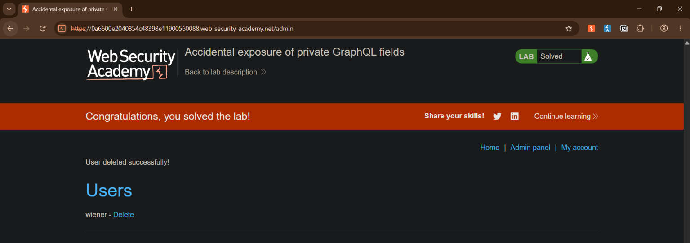

# Accidental Exposure of Private GraphQL Fields

**Platform:** PortSwigger Web Security Academy<br>
**Category:** API Security / GraphQL / Access Control<br>
**Difficulty:** Practitioner<br>
**Date Solved:** 2026-10-30<br>
**Severity:** Critical<br>

## Summary

The blog application's user management runs through a single `POST /graphql/v1` endpoint, with GraphQL introspection left enabled. Running an introspection query revealed the full schema, including a `getUser(id: Int!): User` query and a `User` type defined with `id`, `username`, and `password` fields. The frontend only ever uses `getUser` indirectly (via login/account flows) and never requests `password` back — but nothing server-side stops a client from selecting that field directly, and nothing checks whether the `id` being queried belongs to the requester. The result: any authenticated user can call `getUser` with an arbitrary `id` and have the server hand back that account's plaintext password, with no authorization check at all. Querying `id: 1` returned the `administrator` account's password directly, which was used to log in as admin and delete the user `carlos`, solving the lab.

## Affected Component

- `POST /graphql/v1` — single GraphQL endpoint backing the whole app, with introspection enabled and no field-level authorization on sensitive fields.
- `query getUser(id: Int!): User` — takes an arbitrary numeric ID with no check that it matches the requesting session; returns the full `User` object including `password`.
- `type User { id: Int!, password: String!, username: String! }` — the schema type itself defines `password` as a directly queryable field, with no resolver-level restriction on who can request it.

## Steps to Reproduce

1. Logged in via "My account" using the standard low-privilege lab credentials (`wiener:peter`). Captured the resulting `POST /graphql/v1` login mutation in Burp.
2. Used `/my-account` to trigger the `changeEmail` mutation (editing the account's email field) to get a second authenticated GraphQL request into Burp's history, confirming the endpoint accepts mutations with client-controlled field selections.
3. Attempted to request extra fields (`password`) directly on the `changeEmail` mutation's response — this failed with a schema validation error (`Field 'password' in type 'ChangeEmailResponse' is undefined`), confirming that mutation's return type genuinely has no such field. Rather than keep guessing field names, moved to introspection.
4. Installed/used the **InQL** Burp extension (**Extensions > InQL - GraphQL Scanner > Analyze** on the `/graphql/v1` endpoint) to run a full introspection query and generate a human-readable schema.
5. Opened InQL's **SDL schema** view and read the full type definitions, finding:
   ```graphql
   type User {
     id: Int!
     password: String!
     username: String!
   }

   type query {
     getAllBlogPosts: [BlogPost!]!
     getBlogPost(id: Int!): BlogPost
     getUser(id: Int!): User
   }
   ```
   Confirmed `password` here is a field on an **output type** (`User`, returnable by a query) — distinct from `password` on `LoginInput` (an input-only field used when submitting a login, not something that can be queried back).
6. Built a query by hand in Repeater's GraphQL editor, requesting the `User` type's full field set against a low candidate ID:
   ```graphql
   query {
     getUser(id: 1) {
       id
       username
       password
     }
   }
   ```
7. Sent the request. The response returned `"username":"administrator"` along with the account's plaintext `"password"` value — no authorization check on `id` at all, and no restriction on requesting `password`.
8. Logged in to `/login` as `administrator` using the recovered password, went to the **Admin panel**, and deleted the user `carlos`, solving the lab.

## Proof of Concept

**Query sent (Burp Repeater):**

**Response:**
```json
{
  "data": {
    "getUser": {
      "id": 1,
      "username": "administrator",
      "password": "[REDACTED]"
    }
  }
}
```

**Lab banner confirming solved status after deleting `carlos` as the administrator:**


## Root Cause

Two issues combined:

1. **A field that should never be client-queryable exists directly on a publicly reachable output type.** `User.password` is defined on the same `User` type returned by `getUser`, with no separate, permission-gated type or field-level resolver check. GraphQL's field-selection model means any field defined on a reachable type is requestable by any client that knows (or discovers) its name — there is no implicit "the frontend doesn't use this, so it's safe" protection.
2. **No object-level authorization on `getUser`.** The query accepts any `id` with no check that it belongs to the requesting session — a textbook IDOR, identical in shape to the access-control bugs already covered in BAC/IDOR training, just surfaced through a GraphQL query argument instead of a REST path or URL parameter.

Schema introspection being enabled made discovering both the field's existence and the query's shape essentially free — no field-name guessing was needed once the SDL schema was pulled.

## Impact

**Technical**
- Full plaintext credential disclosure for any user account, including administrator, via a single unauthenticated-from-the-app's-perspective query (any logged-in session, regardless of privilege level, can call it).
- No chaining, no timing attacks, no secondary bug needed — one query is a complete account-takeover primitive.

**Business / Real-World**
- Direct path to full administrative account takeover; in a real deployment this is a S0-class finding (password disclosure + privilege escalation combined).
- The same pattern generalizes to any schema field a developer added for internal/administrative tooling convenience without realizing it was reachable by any authenticated client — session tokens, security-question answers, internal flags, etc.

**Scope**
- Any GraphQL type exposing a sensitive field without resolver-level authorization checks, and any query accepting an object ID without verifying it matches the caller's own identity or permission level.

## Remediation

- Never store or return plaintext passwords from any API, full stop — passwords should be hashed and the hash should never be a GraphQL-queryable field at all.
- Enforce field-level authorization in resolvers for any genuinely sensitive field, independent of whether the frontend ever requests it.
- Enforce object-level authorization on `getUser` (and any ID-accepting query) — verify the requested `id` matches the caller's own identity, or that the caller holds a role permitted to view other users' records.
- Disable introspection in production, or gate it behind authenticated/internal access only, to raise the cost of schema discovery.

## Lessons Learned & Patterns

- **Don't guess field names blind.** Trying `password` directly on `ChangeEmailResponse` failed with a clean schema-validation error naming the exact type (`ChangeEmailResponse`) — that error is a gift, not a dead end: it tells you precisely which type to go examine via introspection instead of continuing to guess.
- **Distinguish output-type fields from input-type fields when scanning a schema for sensitive field names.** A `password` field on an `input` type (e.g. `LoginInput`) is write-only and not exploitable; the same name on an output `type` (e.g. `User`) is a field the server can return to you. Searching a raw schema dump for a keyword will surface both — always check which kind of type the match sits inside before chasing it.
- **Any query that takes a bare `id: Int!` argument with no apparent scoping deserves an IDOR check by default** — same instinct as REST/URL-param IDOR hunting, just expressed as a GraphQL argument instead of a path segment.
- **Pull the full SDL schema via introspection before trying to craft exploit queries by hand.** Trying to extend an existing request's field selection by guessing is slow and noisy; a one-time schema pull gives you every type, field, query, and mutation name up front, turning the rest of the hunt into "which of these obviously-named things was the developer not thinking about."
- **GraphQL requests sent from the same Repeater tab retain stale `operationName`/body fields across edits.** Changing the query text in the GraphQL-aware editor view doesn't always clear leftover fields (e.g. `operationName` from a prior mutation) in the underlying raw JSON body — check the **Raw** tab when a query that looks syntactically correct still errors with an "unknown operation" message.

## References

- PortSwigger Lab: Accidental exposure of private GraphQL fields
- PortSwigger Web Security Academy: GraphQL API vulnerabilities
- OWASP: GraphQL Cheat Sheet (Authorization section)

**Tags:** #PortSwigger #GraphQL #APISecurity #IDOR #BrokenAccessControl #CredentialDisclosure #Critical
