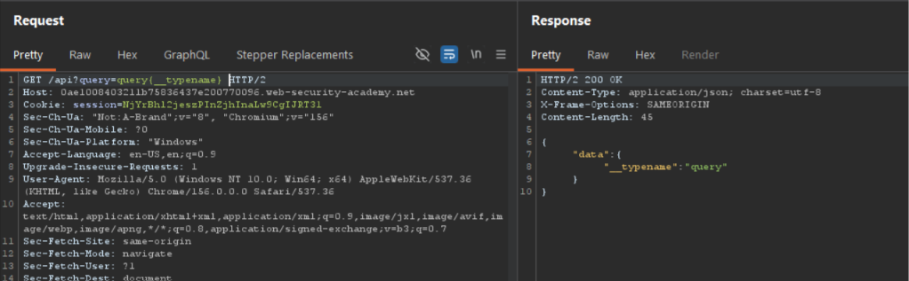

# Hidden GraphQL Endpoint — Introspection Filter Bypass Leading to Unauthorized Object Deletion

**Platform:** PortSwigger Web Security Academy
**Category:** API Security / Access Control
**Difficulty:** Practitioner
**Date Solved:** 2026-10-31
**Severity:** Critical

## Summary

A GraphQL API endpoint exists at `/api` that is not linked from any part of the application's UI and responds to GET requests with the query passed as a URL parameter. Introspection is nominally disabled via a server-side filter, but the filter relies on naive string matching rather than semantic query parsing, making it trivially bypassable. Once the schema was recovered, a `deleteOrganizationUser` mutation was identified that permits deletion of arbitrary user accounts by ID, with no apparent authorization check confirming the caller has rights to delete the target user.

## Affected Component

`/api` — hidden GraphQL endpoint (GET-based query delivery), specifically the `deleteOrganizationUser` mutation and the introspection-blocking filter layer in front of it.

## Steps to Reproduce

1. **Endpoint discovery.** Random/common path guesses against the app returned a generic `Not Found` every time — the normal signal that a path doesn't exist. Common GraphQL path suffixes were tested next via Burp Repeater: `/graphql` also returned 404 `Not Found`. `/api`, however, broke that pattern — instead of `Not Found`, it returned a distinctly different, GraphQL-specific error: `{"errors":[{"message":"Query not present"}]}`. That contrast — every other guessed path giving the same generic 404, `/api` alone giving a structured GraphQL error — was the actual trigger that confirmed a real GraphQL handler lives at this path, not just another dead route.

2. **Endpoint confirmation.**
   ```
   GET /api?query=query{__typename}
   ```
   Response: `{"data":{"__typename":"query"}}` — confirmed live GraphQL endpoint, root query type named `query`.

3. **Introspection attempt — blocked.**
   ```graphql
   query{__schema{types{name}}}
   ```
   Response: `"GraphQL introspection is not allowed, but the query contained __schema or __type"`. This error message reveals the filter's implementation: a substring match on the literal text `__schema`/`__type`, not a semantic parse of the query.

4. **Filter bypass.** A newline was inserted between `__schema` and its opening brace, breaking the literal substring match while remaining valid GraphQL (whitespace between tokens is insignificant per spec):
   ```graphql
   query{__schema
   {types{name}}}
   ```
   Full type listing returned — filter bypassed.

5. **Schema mapping.** Field-level introspection was run against the `query` and `mutation` root types:
   ```graphql
   query{__type
   (name:"query"){fields{name args{name}}}}
   ```
   → `getUser(id)`
   ```graphql
   query{__type
   (name:"mutation"){fields{name args{name}}}}
   ```
   → `deleteOrganizationUser(input)`

   The `input` argument's shape was recovered by introspecting the dedicated input type — noting that input object types expose `inputFields`, not `fields` (field-level introspection on `deleteOrganizationUser` itself returns `null`, since it is a field, not a type):
   ```graphql
   query{__type
   (name:"DeleteOrganizationUserInput"){inputFields{name type{name}}}}
   ```
   → single field, `id`.

6. **Target identification.**
   ```graphql
   query{getUser(id:1){id username}}
   ```
   Small integer IDs were iterated to identify the target user (`carlos`) and corresponding ID.

7. **Exploitation.**
   ```graphql
   mutation{deleteOrganizationUser(input:{id:<carlos_id>}){user{id}}}
   ```
   Request succeeded — target user deleted with no verification that the authenticated session had rights to perform this action against another organization member.

## Proof of Concept

Baseline `{__typename}` request/response confirming the hidden endpoint at `/api` responds to crafted GraphQL queries via GET — this was the initial verification step, run specifically because `/api` had just returned `"Query not present"` (a GraphQL-specific error) instead of the generic `Not Found` every other guessed path returned. That contrast was the signal that justified testing `/api` further rather than moving on:



*(Additional screenshots: introspection-blocked response, bypassed introspection response, final deletion mutation + success response)*

## Root Cause

Two independent failures compound here:
1. Introspection filtering implemented as a text-pattern blocklist instead of parsing the query and rejecting introspection at the AST/semantic level.
2. Missing authorization check on a destructive mutation — `deleteOrganizationUser` does not verify the caller's permission relative to the target user.

## Impact

### Technical
- Full schema enumeration remains possible despite introspection being "disabled," exposing every query, mutation, and input/output type to an attacker.
- `deleteOrganizationUser` performs no apparent object-level authorization check — any authenticated session can delete any other user by ID.
- The endpoint is undiscoverable through normal UI navigation/crawling, meaning standard reconnaissance misses it entirely without active endpoint brute-forcing.

### Business / Real-World
- Unauthorized, authenticated users can destroy other organization members' accounts — direct availability/integrity impact on the customer's user base.
- Combined with the `getUser` query pattern seen elsewhere in this schema (over-exposed fields such as `password` on other labs using the same schema family), this suggests a systemic gap in field- and operation-level authorization across the GraphQL API, not an isolated bug — worth flagging as a pattern, not just a single finding.
- Reputational/compliance risk if this pattern exists in a production multi-tenant SaaS context (one org's low-priv user deleting another org's users, depending on tenant isolation).

### Scope
Confirmed within this lab instance only. In a real engagement, would additionally test: cross-tenant ID ranges, whether the mutation works pre-authentication, and whether other mutations (`changeEmail`, role-modification equivalents) share the same missing-authorization pattern.

## Remediation

1. Disable introspection using the GraphQL engine's native mechanism (disable `__schema`/`__type` resolvers at the schema level) rather than a request-layer text filter.
2. Enforce authentication/authorization on all endpoints regardless of UI linkage — unlinked ≠ protected.
3. Add explicit object-level authorization on all mutations affecting other users' data, verifying caller permission relative to the target object, not just session validity.
4. Rate-limit/alert on introspection attempts and sequential-ID enumeration patterns (e.g. repeated `getUser(id:N)`) in production.

## Lessons Learned & Patterns

- A generic `Not Found` vs. a structured, GraphQL-specific error (`"Query not present"`) on an otherwise-identical blind path guess is a reliable discovery signal — the inconsistency itself is the finding, not any single response in isolation. Worth generalizing: whenever brute-forcing paths, watch for *any* response that breaks the pattern of the surrounding noise, not just unusually-shaped 200s.
- Introspection filters implemented via string/regex matching on raw query text are consistently bypassable with whitespace injection, inline fragments, or field aliasing — check for this class of filter by default on any "introspection disabled" GraphQL target.
- `__type` introspection has two different result shapes depending on what you're inspecting: object types use `fields`, input types use `inputFields`. Querying the wrong one silently returns `null` rather than an error — easy to misread as "this type doesn't exist."
- A field/mutation name (e.g. `deleteOrganizationUser`) is not a type — `__type(name:"<fieldName>")` will always return `null`. To learn a mutation's argument shape, introspect its dedicated Input type instead.
- "Query not present" (GraphQL-specific error) vs. a generic 404 is a reliable signal during endpoint discovery — distinguishes "wrong path" from "right path, missing params."
- General pattern beyond GraphQL: any filter that pattern-matches on raw request text (not a parsed/semantic representation) is a bypass candidate — same logic applies to WAF rules against SQLi/XSS payloads.

## References

- PortSwigger Lab: Finding a hidden GraphQL endpoint
- GraphQL Introspection — https://graphql.org/learn/introspection/

**Tags:** #PortSwigger #GraphQL #BrokenAccessControl #IDOR #APISecurity #IntrospectionBypass
