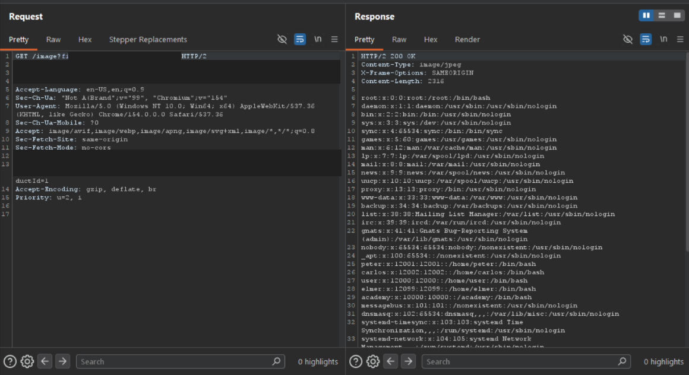

# Lab - File path traversal, simple case

**Platform:** PortSwigger Web Security Academy 
**Category:** Path Traversal 
**Difficulty:** Apprentice 
**Date Solved:** 2026-10-25 
**Severity:** High — CVSS 3.1: 7.5 (conditional estimate), CVSS:3.1/AV:N/AC:L/PR:N/UI:N/S:U/C:H/I:N/A:N.

## Summary

This introductory lab exposed a path traversal vulnerability in the product-image display request. The image endpoint accepted a user-controlled filename. Changing that value to a path that escaped the intended image location caused the server to return the contents of `/etc/passwd` with `200 OK`.

The response demonstrated that the endpoint was not restricting file access to its intended image directory. The file was used as a proof of traversal; it is not itself equivalent to retrieving password hashes or proof that every file on the server is readable.

## Affected Component

- Product image endpoint: `GET /image?filename=...`
- Lab: [File path traversal, simple case](https://portswigger.net/web-security/file-path-traversal/lab-simple)

The lab hostname and session cookie are omitted from this report and redacted from the screenshot.

## Steps to Reproduce

1. In the authorized PortSwigger lab, open a product and inspect the request used to display its image.
2. In Burp Suite, exclude images from the HTTP history MIME-type filters so the image request is visible.
3. Inspect the `filename` parameter and, in the lab request only, change it to the traversal value used to reach `/etc/passwd`.
4. Send the modified request and inspect the response. The server returned `200 OK` with passwd-file entries instead of the expected image.

## Proof of Concept

The screenshot shows the product-image request and a successful response containing `/etc/passwd` data. The lab host and session cookie have been redacted.

## Root Cause

The application used a user-controlled path value to locate a file but did not confine the resolved path to the intended product-image directory. Relative parent-directory components can change the path resolution from the expected location when the application joins the input to a base path without adequate validation.

The exact number of parent-directory components needed depends on the effective base path and how the framework and operating system normalize the request. It is not a fixed count that should be assumed for other applications.

## Impact

**Technical**
- A user could cause the endpoint to return local files that are readable by the application process, subject to the process's permissions and the platform's filesystem layout.
- The lab demonstrated reading `/etc/passwd`. On many Linux systems, this file contains account metadata, not password hashes; protected password hashes are ordinarily stored separately and are not readable by unprivileged processes.

**Business / Real-World**
- If sensitive application files or secrets are readable by the vulnerable process, unauthorized disclosure could expose credentials, configuration, or other data.
- The actual impact depends on the operating system, application permissions, path base, and which files are accessible. The lab result alone does not establish the contents or exposure of any real system.

**Scope**
- Demonstrated only against the isolated PortSwigger Web Security Academy lab. No production system was tested.

## Remediation

- Avoid accepting filesystem paths from users; use server-side identifiers mapped to approved files.
- If paths must be accepted, resolve them to canonical paths and verify the result remains within the intended directory before opening the file.
- Use a strict allowlist of valid image identifiers or filenames and reject path separators and traversal components as defense in depth.
- Run the application with least privilege and restrict its access to sensitive filesystem locations.
- Add tests for path normalization, encoded separators, and platform-specific path handling.

## Investigation Notes

- **Initial clue:** The lab description said the issue affected the “display of product images.” I treated that as a hint to inspect image requests, then excluded images from the filter to make the request visible.
- **Question:** Is `/etc/passwd` the sensitive path, or is the lesson to substitute another sensitive path in a real attack? It is a conventional proof file because it is commonly readable on Linux and demonstrates that the server resolved a path outside the image directory. The report does not treat it as containing password hashes. Any testing beyond an authorized lab must remain within explicit scope.
- **Question:** What does `../` mean, and is it universal? On Unix-like filesystems, `..` is the parent-directory component and `/` separates path components. Windows commonly uses `..\`; accepted separators and normalization depend on the platform and application. The traversal sequence is not a universal fixed string: its effect depends on the resolved base directory and path-handling behavior.
- **Methodology:** Before testing image-display behavior, exclude images in Burp's HTTP history MIME-type filters so the relevant requests are not hidden.

## Lessons Learned & Patterns

- A request that appears to fetch an image can still be a file-read surface; inspect the request and its parameters rather than relying on the UI label.
- `../` represents a relative parent-directory component on Unix-like systems; Windows and application libraries may handle separators differently.
- The required traversal depth depends on the effective base path and normalization behavior, not on a universal number of `../` segments.
- `/etc/passwd` is a common Linux proof file, not a password-hash database and not a guarantee that arbitrary sensitive files are readable.
- Confirm both the response status and body. A `200 OK` response containing file data provided evidence that the path value affected server-side file resolution.

## References

- [PortSwigger Web Security Academy: File path traversal, simple case](https://portswigger.net/web-security/file-path-traversal/lab-simple)
- [PortSwigger: Directory traversal](https://portswigger.net/web-security/file-path-traversal)
- [Path traversal wordlist](https://github.com/MalikHettige/Bug-bounty-writeups/blob/main/resources/Path-traversal-wordlist.txt)
- [OWASP: Path Traversal](https://owasp.org/www-community/attacks/Path_Traversal)
- [CWE-22: Improper Limitation of a Pathname to a Restricted Directory](https://cwe.mitre.org/data/definitions/22.html)

**Tags:** #PortSwigger #PathTraversal #FileDisclosure
