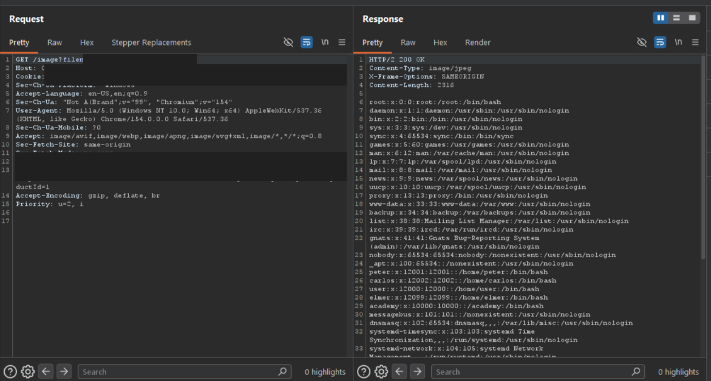

# Lab - File path traversal, traversal sequences blocked with absolute path bypass

**Platform:** PortSwigger Web Security Academy 
**Category:** Path Traversal 
**Difficulty:** Practitioner 
**Date Solved:** 2026-10-25 
**Severity:** High — CVSS 3.1: 7.5 (conditional estimate), CVSS:3.1/AV:N/AC:L/PR:N/UI:N/S:U/C:H/I:N/A:N.

## Summary

This lab's product-image endpoint blocked traversal sequences but still accepted an absolute filesystem path as the image filename. Supplying an absolute path to the lab's image request returned `/etc/passwd` contents with `200 OK`.

The key lesson is that blocking parent-directory sequences alone does not guarantee that a requested path stays inside an intended base directory. Path resolution and path-joining semantics must also be considered.

## Affected Component

- Product image endpoint: `GET /image?filename=...`
- Lab: [File path traversal, traversal sequences blocked with absolute path bypass](https://portswigger.net/web-security/file-path-traversal/lab-absolute-path-bypass)

The lab hostname and session cookie are omitted and redacted from the screenshot.

## Steps to Reproduce

1. In the authorized PortSwigger lab, open a product and inspect the request used to display its image.
2. In Burp Suite, exclude images from the HTTP history MIME-type filters so the image request is visible.
3. Observe that relative traversal sequences are blocked. In the lab request, replace the filename with an absolute path to a readable proof file.
4. Send the request and inspect the response. The server returned `200 OK` with passwd-file entries.

## Proof of Concept

The screenshot shows the product-image request returning file contents from the absolute-path test. The host, session cookie, and exact path value are redacted.

## Root Cause

The application attempted to restrict traversal by blocking relative traversal sequences, but did not ensure that the final resolved file remained within the intended image directory. Some path-joining APIs treat an absolute second path as a replacement for the base path. Other code may simply concatenate strings, producing different behavior. The exact result depends on the language, library, and code used to construct and open the path.

Accordingly, the issue should not be described as every string concatenation automatically allowing an absolute path to override its prefix. The security requirement is to validate the canonical resolved path before opening it, regardless of the particular join or concatenation semantics.

## Impact

**Technical**
- A user could cause the endpoint to return local files readable by the application process, subject to its permissions and filesystem layout.
- The lab demonstrated reading `/etc/passwd`, which commonly contains account metadata rather than password hashes.

**Business / Real-World**
- If sensitive application files or secrets are readable by the vulnerable process, unauthorized disclosure could expose credentials, configuration, or other data.
- Actual impact depends on the endpoint's access controls, platform, path handling, and the files readable by the application process.

**Scope**
- Demonstrated only against the isolated PortSwigger Web Security Academy lab. No production system was tested.

## Remediation

- Do not rely on filtering `../` or similar traversal strings as the primary control.
- Prefer server-side file identifiers mapped to approved resources instead of accepting paths from users.
- Canonicalize the candidate path and verify it remains within the intended directory before opening it.
- Apply least-privilege filesystem permissions and restrict the application process's access to sensitive files.
- Test absolute paths and platform-specific path forms in addition to relative traversal cases.

## Investigation Notes

- **Key observation:** The relative traversal form was blocked, but the absolute-path form still returned file contents. The filter addressed one syntax rather than enforcing the intended directory boundary.
- **Concept clarification:** Some path-joining functions reset to an absolute second path; raw string concatenation does not necessarily do so. The behavior is implementation-specific, so inspect the actual path-resolution behavior rather than assuming every join behaves identically.
- **Methodology:** Before testing image-display behavior, exclude images from Burp's HTTP history MIME-type filters so the relevant requests are visible.

## Lessons Learned & Patterns

- A traversal filter can reject familiar relative sequences while leaving absolute-path handling unprotected.
- Enforce the security invariant on the final canonical path: it must remain under the approved base directory.
- Distinguish path-joining APIs from raw string concatenation; their semantics vary by language and library.
- `/etc/passwd` is a proof file in the lab, not evidence that password hashes or every system file are exposed.

## References

- [PortSwigger Web Security Academy: File path traversal, traversal sequences blocked with absolute path bypass](https://portswigger.net/web-security/file-path-traversal/lab-absolute-path-bypass)
- [PortSwigger: Directory traversal](https://portswigger.net/web-security/file-path-traversal)
- [Path traversal wordlist](https://github.com/MalikHettige/Bug-bounty-writeups/blob/main/resources/Path-traversal-wordlist.txt)
- [OWASP: Path Traversal](https://owasp.org/www-community/attacks/Path_Traversal)
- [CWE-22: Improper Limitation of a Pathname to a Restricted Directory](https://cwe.mitre.org/data/definitions/22.html)

**Tags:** #PortSwigger #PathTraversal #FileDisclosure
