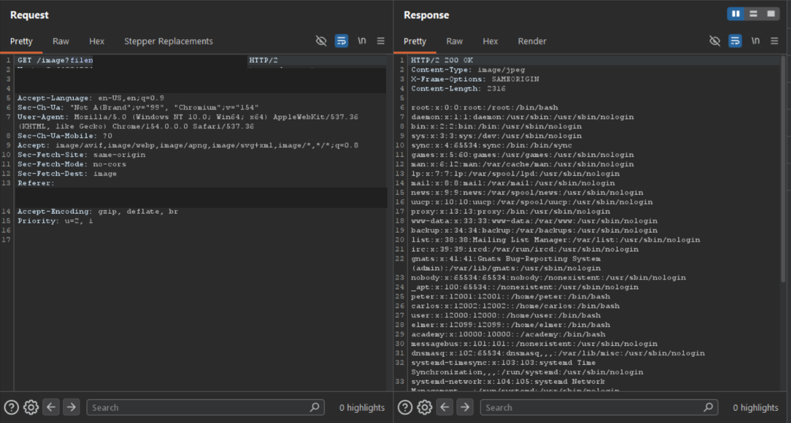

# Lab - File path traversal, traversal sequences stripped non-recursively

**Platform:** PortSwigger Web Security Academy 
**Category:** Path Traversal 
**Difficulty:** Practitioner 
**Date Solved:** 2026-10-25 
**Severity:** High — CVSS 3.1: 7.5 (conditional estimate), CVSS:3.1/AV:N/AC:L/PR:N/UI:N/S:U/C:H/I:N/A:N.

## Summary

The product-image endpoint attempted to block path traversal by stripping matching traversal sequences from the supplied filename. The sanitization was non-recursive: it removed matching text once but did not validate the resulting value again. A crafted value therefore re-formed a traversal sequence after the removal, and the server returned `/etc/passwd` contents with `200 OK`.

This is a broader single-pass sanitization flaw: removing a substring is not sufficient when the remaining text can combine into another prohibited pattern.

## Affected Component

- Product image endpoint: `GET /image?filename=...`
- Lab: [File path traversal, traversal sequences stripped non-recursively](https://portswigger.net/web-security/file-path-traversal/lab-sequences-stripped-non-recursively)

The lab hostname and session cookie are omitted and redacted from the screenshot.

## Steps to Reproduce

1. In the authorized PortSwigger lab, open a product and inspect the request used to display its image.
2. In Burp Suite, exclude images from the HTTP history MIME-type filters so the image request is visible.
3. Observe that the application strips traversal sequences from the filename. Construct a lab-only test value in which removal of the matched text leaves characters that re-form a traversal sequence.
4. Use enough repeated components to reach the intended proof file, then send the request.
5. Inspect the response; the server returned `200 OK` with passwd-file entries.

## Proof of Concept

The screenshot shows the product-image request and a successful response containing file data. The lab host, session cookie, and exact test value are redacted.

## Root Cause

The input filter removed a matched sequence in a single pass and trusted the resulting string. It did not repeatedly sanitize or, more importantly, enforce that the final resolved file remained within the approved image directory. Text that was not itself matched could become a prohibited sequence after the removal step.

This pattern is not unique to path traversal. Any sanitizer that deletes or transforms input once can be vulnerable when that transformation allows previously separated characters to form a new meaningful token. Similar filter-design errors can affect markup and query-language handling.

## Impact

**Technical**
- A user could cause the endpoint to return local files readable by the application process, subject to its permissions and filesystem layout.
- The lab demonstrated reading `/etc/passwd`, which commonly contains account metadata rather than password hashes.

**Business / Real-World**
- If sensitive application files or secrets are readable by the vulnerable process, unauthorized disclosure could expose credentials, configuration, or other data.
- Actual impact depends on the endpoint's access controls, operating system, path handling, and the files readable by the application process.

**Scope**
- Demonstrated only against the isolated PortSwigger Web Security Academy lab. No production system was tested.

## Remediation

- Do not rely on deleting known traversal substrings as the primary security control.
- Prefer server-side file identifiers mapped to approved resources instead of accepting paths from users.
- Resolve the candidate path canonically and verify it remains inside the intended directory before opening it.
- Apply least-privilege filesystem permissions and restrict the application process's access to sensitive files.
- If normalization is necessary, apply a well-defined canonicalization process before validation and validate the final representation; avoid ambiguous repeated decoding or transformation.
- Add tests for inputs that can reconstruct blocked tokens after sanitization.

## Investigation Notes

- **Trigger:** The application appeared to remove traversal syntax, but the filter made only one pass and did not inspect the transformed result.
- **Diagnostic question:** When a filter strips a pattern, does it validate the final normalized value, or can removal make a new prohibited sequence appear? This lab demonstrated the latter.
- **Methodology:** Before testing image-display behavior, exclude images from Burp's HTTP history MIME-type filters so the relevant requests are visible.

## Lessons Learned & Patterns

- One-pass removal is not equivalent to safe normalization: transformations can expose or create new matches.
- Enforce the final security invariant on the canonical resolved path, rather than assuming a string filter makes it safe.
- The same general design error can occur in different input-filtering contexts; reason about how transformations affect the complete parsed value.
- `/etc/passwd` is a proof file in the lab, not evidence that password hashes or every system file are exposed.

## References

- [PortSwigger Web Security Academy: File path traversal, traversal sequences stripped non-recursively](https://portswigger.net/web-security/file-path-traversal/lab-sequences-stripped-non-recursively)
- [PortSwigger: Directory traversal](https://portswigger.net/web-security/file-path-traversal)
- [Path traversal wordlist](https://github.com/MalikHettige/Bug-bounty-writeups/blob/main/resources/Path-traversal-wordlist.txt)
- [OWASP: Path Traversal](https://owasp.org/www-community/attacks/Path_Traversal)
- [CWE-22: Improper Limitation of a Pathname to a Restricted Directory](https://cwe.mitre.org/data/definitions/22.html)

**Tags:** #PortSwigger #PathTraversal #FileDisclosure
