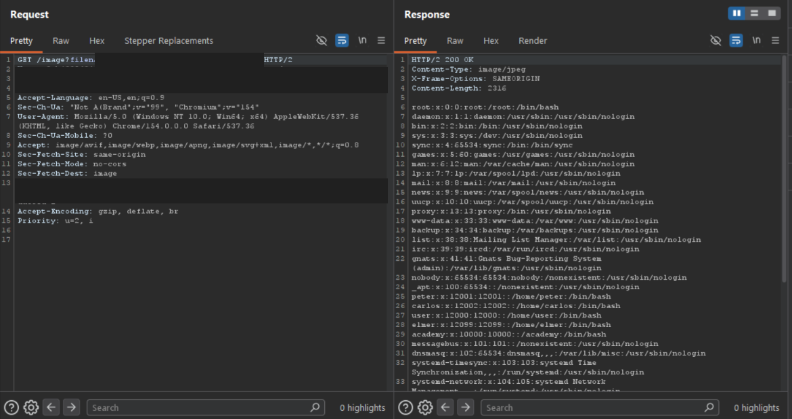

# Lab - File path traversal, traversal sequences stripped with superfluous URL-decode

**Platform:** PortSwigger Web Security Academy 
**Category:** Path Traversal 
**Difficulty:** Practitioner 
**Date Solved:** 2026-10-25 
**Severity:** High — CVSS 3.1: 7.5 (conditional estimate), CVSS:3.1/AV:N/AC:L/PR:N/UI:N/S:U/C:H/I:N/A:N.

## Summary

The product-image endpoint attempted to strip traversal sequences from the supplied filename, but a later URL-decoding step transformed the remaining encoded value into a usable path. In the authorized lab, the request returned `/etc/passwd` contents with `200 OK`.

The underlying weakness was an order-of-operations mismatch: validation did not account for the value after all decoding and normalization steps had completed.

## Affected Component

- Product image endpoint: `GET /image?filename=...`
- Lab: [File path traversal, traversal sequences stripped with superfluous URL-decode](https://portswigger.net/web-security/file-path-traversal/lab-superfluous-url-decode)

The lab hostname and session cookie are omitted and redacted from the screenshot.

## Steps to Reproduce

1. In the authorized PortSwigger lab, open a product and inspect the request used to display its image.
2. In Burp Suite, exclude images from the HTTP history MIME-type filters so the image request is visible.
3. Observe that direct traversal syntax is filtered. Test, within the lab, whether URL-decoding occurs after the filtering step or is applied more than once.
4. Send the lab request with an encoded test value; the exact value is redacted from the screenshot.
5. Inspect the response. The server returned `200 OK` with passwd-file entries.

## Proof of Concept

The screenshot shows the image request returning file data after the encoded-input test. The lab host, session cookie, and exact encoded value are redacted.

## Root Cause

The application checked one representation of the filename, then decoded or otherwise transformed it before using it to select a file. An encoded value that did not match the filter could become path syntax after the check. Repeated decoding can create the same mismatch when validation and use operate on different decoding stages.

This is an order-of-operations flaw: security checks must apply to the final canonical representation that will be used for file access, not an earlier encoded form.

## Impact

**Technical**
- A user could cause the endpoint to return local files readable by the application process, subject to its permissions and filesystem layout.
- The lab demonstrated reading `/etc/passwd`, which commonly contains account metadata rather than password hashes.

**Business / Real-World**
- If sensitive application files or secrets are readable by the vulnerable process, unauthorized disclosure could expose credentials, configuration, or other data.
- Actual impact depends on endpoint access controls, decoding behavior, operating system, and the files readable by the application process.

**Scope**
- Demonstrated only against the isolated PortSwigger Web Security Academy lab. No production system was tested.

## Remediation

- Decode and canonicalize input exactly once at a well-defined boundary, before validation.
- Validate the final canonical path and verify it remains within the intended directory before opening it.
- Avoid substring stripping as the primary control; prefer server-side file identifiers mapped to approved resources.
- Ensure downstream components do not decode or normalize the value again after the security check.
- Add tests for single and repeated decoding, path normalization, and other transformations used by the application.

## Investigation Notes

- **Key observation:** The filter and the later decoding step did not operate on the same representation of the filename. The encoded value passed the check, then became path syntax during later processing.
- **Connection to the previous lab:** Both labs demonstrate validation/processing mismatches. In the non-recursive case, removal created a new matching sequence; here, decoding created path syntax after the filter had run.
- **General diagnostic:** When an application both validates and transforms input, establish the order of those operations and verify that the checked value is the same canonical value ultimately used.
- **Methodology:** Before testing image-display behavior, exclude images from Burp's HTTP history MIME-type filters so the relevant requests are visible.

## Lessons Learned & Patterns

- Validate after decoding and canonicalization, and ensure no later layer transforms the value into a different security-relevant form.
- Multiple decoding layers can cause validation and use to interpret the same parameter differently.
- The same ordering concern applies to other normalization and decoding operations; test the application's actual processing pipeline rather than assuming the raw request is the final value.
- `/etc/passwd` is a proof file in the lab, not evidence that password hashes or every system file are exposed.

## References

- [PortSwigger Web Security Academy: File path traversal, traversal sequences stripped with superfluous URL-decode](https://portswigger.net/web-security/file-path-traversal/lab-superfluous-url-decode)
- [PortSwigger: Directory traversal](https://portswigger.net/web-security/file-path-traversal)
- [Path traversal wordlist](https://github.com/MalikHettige/Bug-bounty-writeups/blob/main/resources/Path-traversal-wordlist.txt)
- [OWASP: Path Traversal](https://owasp.org/www-community/attacks/Path_Traversal)
- [CWE-22: Improper Limitation of a Pathname to a Restricted Directory](https://cwe.mitre.org/data/definitions/22.html)

**Tags:** #PortSwigger #PathTraversal #FileDisclosure #InputValidation
