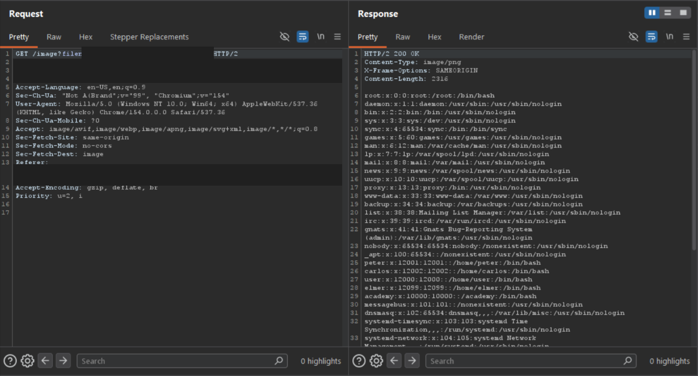

# Lab - File path traversal, validation of file extension with null byte bypass

**Platform:** PortSwigger Web Security Academy 
**Category:** Path Traversal 
**Difficulty:** Practitioner 
**Date Solved:** 2026-10-25 
**Severity:** High — CVSS 3.1: 7.5 (conditional estimate), CVSS:3.1/AV:N/AC:L/PR:N/UI:N/S:U/C:H/I:N/A:N.

## Summary

The product-image endpoint required the supplied filename to end with an approved image extension. In the lab, a null-byte parsing mismatch caused validation and file access to interpret the same value differently. The server returned `/etc/passwd` contents with `HTTP/2 200 OK` despite the extension check.

This technique depends on how the target stack handles null bytes and strings. The lab result should not be taken to mean that modern runtimes or filesystems generally truncate paths this way.

## Affected Component

- Product image endpoint: `GET /image?filename=...`
- Lab: File path traversal, validation of file extension with null byte bypass

## Steps to Reproduce

1. In the authorized PortSwigger lab, open a product and inspect the request used to display its image.
2. In Burp Suite HTTP history, locate the image request and note the `filename` parameter and the required image extension.
3. Test whether the validation layer and the component opening the file interpret a null byte consistently. The exact lab payload is omitted from this report.
4. Inspect the response. The lab returned `HTTP/2 200 OK` with a long body containing `/etc/passwd` entries.

## Proof of Concept

The attached evidence shows the product-image request and the successful file-read response. The lab host, session cookie, and exact request value are redacted.

## Root Cause

The endpoint enforced an extension rule on a user-controlled filename, but a downstream parsing or file-handling layer interpreted the value differently. A null byte can act as a string terminator in some legacy or unsafe interfaces; if validation checks text beyond that point while file access treats it as the end, the extension check and the opened path can disagree.

The exact behavior is runtime- and API-dependent. The general defect is inconsistent interpretation across validation and file access, not a universal property of current operating systems.

## Impact

**Technical**
- A user could cause the endpoint to return local files readable by the application process, subject to its permissions and the behavior of the relevant runtime.
- The lab demonstrated reading `/etc/passwd`, which commonly contains account metadata rather than password hashes.

**Business / Real-World**
- If sensitive application files or secrets are readable by the vulnerable process, unauthorized disclosure could expose credentials, configuration, or other data.
- Practical exploitability depends on the language/runtime, filesystem APIs, validation logic, and application permissions. The lab does not establish that a modern production stack has the same behavior.

**Scope**
- Demonstrated only against the isolated PortSwigger Web Security Academy lab. No production system was tested.

## Remediation

- Avoid accepting filesystem paths from users; map server-side identifiers to approved files.
- Do not rely on a filename extension as a path-containment control.
- Reject null bytes and other invalid path characters at the input boundary, while ensuring every downstream component uses the same canonical representation.
- Canonicalize and validate the final path against the intended directory before opening the file.
- Use maintained runtimes and filesystem APIs, and add regression tests for parser differences and invalid path encodings.

## Investigation Notes

- **Observation:** The request contained a filename that appeared to satisfy the image-extension requirement, while the response contained file data rather than an image.
- **Question to investigate on real systems:** Do validation and the file-opening API interpret the exact same value? This must be assessed only within authorized scope and with attention to current runtime behavior.
- **Evidence:** The response status was `HTTP/2 200 OK`, and the body contained passwd-file entries. This confirms the lab outcome; it does not identify the exact internal API or prove that all targets accept null-byte truncation.

## Lessons Learned & Patterns

- Security checks and file access must agree on the canonical value being processed.
- An extension allowlist does not prevent path traversal if the resolved path is not confined to the intended directory.
- Null-byte truncation is legacy- and implementation-dependent; do not assume it works on modern stacks.
- `/etc/passwd` is a lab proof file, not evidence that password hashes or every system file are exposed.

## References

- [PortSwigger: Directory traversal](https://portswigger.net/web-security/file-path-traversal)
- [Path traversal wordlist](https://github.com/MalikHettige/Bug-bounty-writeups/blob/main/resources/Path-traversal-wordlist.txt)
- [OWASP: Path Traversal](https://owasp.org/www-community/attacks/Path_Traversal)
- [CWE-22: Improper Limitation of a Pathname to a Restricted Directory](https://cwe.mitre.org/data/definitions/22.html)

**Tags:** #PortSwigger #PathTraversal #FileDisclosure #NullByte
