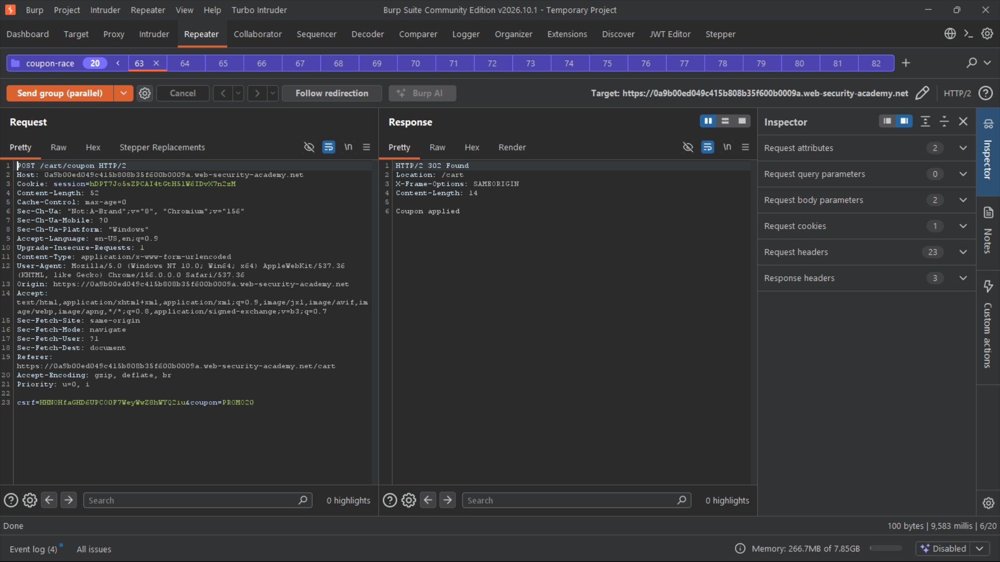
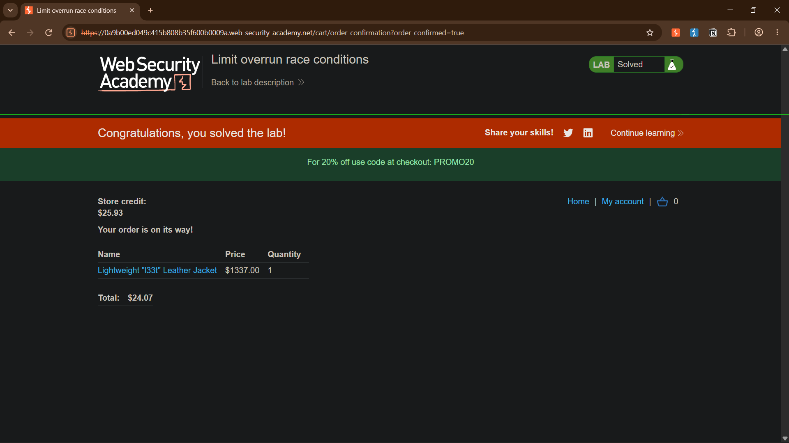

# Limit Overrun Race Conditions

**Platform:** PortSwigger Web Security Academy<br>
**Category:** Business Logic / Race Conditions<br>
**Difficulty:** Apprentice<br>
**Date Solved:** 2026-11-03<br>
**Severity:** High (lab scenario; financial impact via discount stacking)

## Summary

The shop lets a user apply a promo code (`PROMO20`, 20% off) only once per order. The "already applied" check and the "mark coupon as applied" write are not atomic. By firing many `POST /cart/coupon` requests inside the same tiny time window, every request passes the check before any of them records the coupon, so the discount stacks multiple times. A $1337 Lightweight "l33t" Leather Jacket was bought for $24.07 using $50 of store credit.

## Affected Component

- Endpoint: `POST /cart/coupon`
- Parameters: `csrf`, `coupon`
- Logic: one-time coupon enforcement (check-then-act on server-side cart state)

## Steps to Reproduce

1. Log in and add the Lightweight "l33t" Leather Jacket to the cart.
2. Apply `PROMO20` once through the normal flow and capture the `POST /cart/coupon` request in Burp.
3. Re-send the same request once. The server rejects it as already applied, so the limit works sequentially.
4. Send the request to Repeater and duplicate the tab 20 times.
5. Put all 20 tabs in one tab group.
6. Remove the coupon from the cart so the state is clean before racing.
7. Set the send mode to **Send group (parallel)**. Over HTTP/2 this uses the single-packet attack, so all requests arrive together.
8. Send the group, then reload the cart. The total is far below the original price.
9. Place the order. The lab is marked solved.

## Proof of Concept

Request (session and CSRF values redacted):

```http
POST /cart/coupon HTTP/2
Host: <lab-id>.web-security-academy.net
Cookie: session=<redacted>
Content-Type: application/x-www-form-urlencoded

csrf=<redacted>&coupon=PROMO20
```

- Sent as a group of 20 requests, in parallel, over HTTP/2.
- Responses: `HTTP/2 302 Found`, `Location: /cart`, body `Coupon applied`.
- Result: order total dropped from $1337.00 to **$24.07**, paid with store credit (balance left: $25.93).





## Root Cause

Time-of-check to time-of-use (TOCTOU) gap on the coupon limit. The server reads the cart state ("has a coupon been applied?"), then later writes the new state. Requests that arrive inside that window all read the old state and all succeed. There is no lock, no atomic update and no uniqueness constraint tying a coupon to a cart.

## Impact

### Technical

- A per-order limit can be bypassed with a single burst of parallel requests.
- Any "use once" control built the same way (check, then write) is likely vulnerable.

### Business / Real-World

- Direct financial loss: near-free products by stacking discounts.
- Scales easily: a script can repeat it on every order.
- The same pattern appears in gift card redemption, referral bonuses, balance transfers, withdrawals and OTP attempt limits.

### Scope

- Any authenticated user with a cart.
- Sequential testing shows no flaw, so it would be missed by normal QA and basic scanners.

## Remediation

- Make the check and the write atomic: a single conditional database update, or a transaction with row-level locking.
- Enforce uniqueness at the database layer (for example, a unique constraint on `cart_id + coupon_id`).
- Recalculate totals server-side from the stored coupon set, not from a running multiplier.
- Add idempotency keys on state-changing endpoints.
- Do not rely on rate limiting alone. It does not stop a single-packet burst.

## Lessons Learned & Patterns

- Test the limit sequentially first. Only race it when the sequential behavior shows a limit exists.
- Single-packet attack (Burp tab group, Send group in parallel on HTTP/2) beats hand-rolled threading.
- Reset the state (remove the coupon) before each attempt, or the result is misleading.
- Real-world targets: coupons, gift cards, credits, withdrawals, invites, OTP and 2FA attempt limits.
- Submit confirmed findings immediately instead of holding them for a bigger chain.

## References

- PortSwigger Lab: Limit overrun race conditions
- PortSwigger Research: Smashing the state machine (race conditions)
- OWASP: Business Logic Vulnerabilities

**Tags:** #PortSwigger #RaceCondition #BusinessLogic #TOCTOU #SinglePacketAttack
